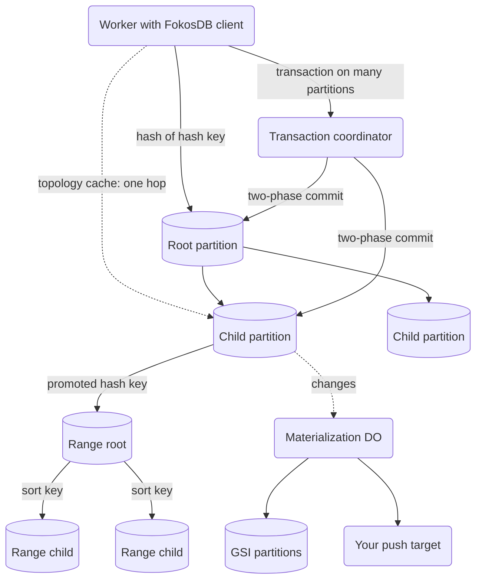

# FokosDB

FokosDB is a strongly consistent, distributed database with bottomless storage, built on top of Cloudflare Durable Objects. Your table grows as long as your account can create Durable Objects: FokosDB splits its partitions automatically, so you never plan capacity. It has the API and the transaction model of Amazon DynamoDB, plus SQLite expressions that DynamoDB does not have.

> [!CAUTION]
> **Do NOT use FokosDB in production, yet.** Breaking changes still occur. Do not store data that you must keep until a stable version is published.

- **Strongly consistent.** You identify each item by a hash key and an optional sort key. Each read and each write of an item is strongly consistent.
- **Bottomless.** A partition that gets too large splits into child partitions, and a hash key that gets too large moves into a range tree of its own.
- **ACID transactions.** Write up to 100 items (4 MB in total) atomically across partitions, or read up to 100 items as one consistent snapshot.
- **SQLite expressions.** Conditions, updates, filters, and projections use JSON paths, arithmetic, and the SQLite core and math functions.
- **GSIs and push targets.** Add up to 10 global secondary indexes to a table, and send each change to your own Worker or Durable Object.
- **Small client.** `fokosdb/client` is 37.8 kB minified and gzipped.
- **Your Cloudflare account.** All data stays in Durable Objects of your account, and one option keeps a table in the EU, the US, or FedRAMP.

```ts
await db.putItem({
  hashKey: "user#1",
  sortKey: "order#001",
  data: { total: 42 },
});
await db.putItem({
  hashKey: "user#1",
  sortKey: "order#002",
  data: { total: 7 },
});

const { items } = await db.queryItems({
  queries: [
    {
      hashKey: "user#1",
      sortKeyCondition: { op: "begins_with", prefix: "order#" },
    },
  ],
});
// items => [
//   { sortKey: "order#001", data: { total: 42 }, ... },
//   { sortKey: "order#002", data: { total: 7 }, ... },
// ]
```

**Expressions that DynamoDB does not have.** Conditions, updates, query filters, and projections can call SQLite functions, and the partition runs them next to the data. This example shows an update and a projection:

```ts
const data = (path: string) => ({ ref: "data", path }) as const;
await db.putItem({
  hashKey: "user#ada",
  data: { name: "ada", country: "de", credit: 100 },
});

// In one atomic update: add 7.5% interest, rounded to one decimal,
// and build a slug from two fields.
await db.transactWriteItems({
  items: [
    {
      operation: "update",
      hashKey: "user#ada",
      update: [
        {
          action: "set",
          target: data("$.credit"),
          value: {
            fn: "sqlite.round",
            args: [
              { fn: "*", args: [data("$.credit"), { val: 1.075 }] },
              { val: 1 },
            ],
          },
        },
        {
          action: "set",
          target: data("$.slug"),
          value: {
            fn: "sqlite.concat",
            args: [data("$.country"), { val: "-" }, data("$.name")],
          },
        },
      ],
    },
  ],
});

// Read only what you need, computed by SQLite inside the partition.
const { item } = await db.getItem({
  hashKey: "user#ada",
  projection: [
    { expr: { fn: "sqlite.upper", args: [data("$.name")] }, as: "name" },
    { expr: data("$.credit"), as: "credit" },
    { expr: data("$.slug"), as: "slug" },
  ],
});
// item.data => { name: "ADA", credit: 107.5, slug: "de-ada" }
```

Read why FokosDB works this way in the article [FokosDB: A strongly consistent bottomless storage database on top of Cloudflare Durable Objects](https://www.lambrospetrou.com/articles/fokosdb), or ask questions about the code on [DeepWiki](https://deepwiki.com/lambrospetrou/fokosdb).

---

## Table of contents

- [Getting started](#getting-started)
- [Features](#features)
- [How it works](#how-it-works)
- [Limitations](#limitations)
- [The Fokos Sharding Runtime](#the-fokos-sharding-runtime)
- [Learn more](#learn-more)
- [Contributing](#contributing)
- [Development](#development)
- [Roadmap and TODOs](#roadmap-and-todos)

## Getting started

These steps add FokosDB to an existing Cloudflare Workers project.

**1. Install the package.** Each commit on `main` publishes a preview build. `@main` installs the newest one:

```sh
npm install https://pkg.pr.new/fokosdb@main
```

`@main` moves with each commit. For an install that you can reproduce, pin a commit SHA, for example `https://pkg.pr.new/lambrospetrou/fokosdb@afce6cb`.

**2. Re-export the Durable Object classes from the main module of your Worker.** Wrangler finds a Durable Object class only in your own entry module. An import is not sufficient.

```ts
// src/index.ts
export {
  FokosDBPartitionDO,
  FokosDBTransactionCoordinatorDO,
} from "fokosdb/server";
```

**3. Add the bindings and the migration to `wrangler.jsonc`.**

```jsonc
{
  "durable_objects": {
    "bindings": [
      { "name": "FOKOSDB_PARTITION_DO", "class_name": "FokosDBPartitionDO" },
      {
        "name": "FOKOSDB_TRANSACTION_COORDINATOR_DO",
        "class_name": "FokosDBTransactionCoordinatorDO",
      },
    ],
  },
  "migrations": [
    {
      "tag": "v1",
      "new_sqlite_classes": [
        "FokosDBPartitionDO",
        "FokosDBTransactionCoordinatorDO",
      ],
    },
  ],
}
```

**4. Create the client and use it.** The client gets the bindings from the `env` of `cloudflare:workers`, so you can create it one time at module scope.

In this example, one Worker is both the client and the server: `src/index.ts` exports the Durable Object classes that store the data, and its `fetch` handler uses the `FokosDB` client to read and write it. A Worker that only reads and writes can import `fokosdb/client` alone and use the Durable Objects of another Worker.

```ts
// src/index.ts: both the client and the server of FokosDB
import { FokosDB } from "fokosdb/client";

export {
  FokosDBPartitionDO,
  FokosDBTransactionCoordinatorDO,
} from "fokosdb/server";

const db = new FokosDB({
  // The identity of the table.
  // Never change these values after the table has data.
  table: {
    name: "my-table",
    ns: "FOKOSDB_PARTITION_DO",
    nsTx: "FOKOSDB_TRANSACTION_COORDINATOR_DO",
    rootTreesN: 10,
    hashSplitN: 4,
  },
});

export default {
  async fetch() {
    await db.putItem({
      hashKey: "user#1",
      sortKey: "profile",
      data: { name: "Ada" },
    });
    const { item } = await db.getItem({
      hashKey: "user#1",
      sortKey: "profile",
    });
    return Response.json(item);
  },
} satisfies ExportedHandler<Env>;
```

**5. Run it.**

```sh
npx wrangler dev
```

> **The full guide is in [`packages/fokosdb/README.md`](./packages/fokosdb/README.md).** It explains the table options, how to change them safely during a deploy, jurisdictions, the topology cache, GSIs, and push targets.

## Features

- **Strong consistency.** FokosDB stores each item, identified by a hash key and an optional sort key, in one partition. Each read and each write of that item is strongly consistent.
- **All the item operations you need.** Use `putItem`, `getItem`, and `deleteItem` for one item, and `batchGetItems` and `batchWriteItems` for up to 100 items in one call. Use `queryItems` to read the items of a hash key in sort-key order, and set `ttlAt` to delete an item automatically.
- **Expressions with the power of SQLite.** Conditions, updates, query filters, and projections read any JSON path of an item. They use arithmetic, `LIKE`, `GLOB`, `IIF`, `COALESCE`, and the other SQLite string and math functions. The partition runs each expression as SQL, next to the data.
- **ACID transactions across partitions.** `transactWriteItems` writes items in different partitions atomically, with the two-phase commit of the DynamoDB papers. `transactGetItems` reads them as one consistent snapshot. A client request token makes a retry safe.
- **Ordered operations on one item.** With `executionMode: "ordered_per_item"`, one transaction can write the same item more than one time, in the order that you give. DynamoDB does not let you do this.
- **A fast path for one partition.** When one partition holds all the items of a transaction, FokosDB completes it in one round trip.
- **Automatic partition splits.** When a partition gets too large, it splits into child partitions and moves its data in the background. Reads continue during the split, and you never reshard manually.
- **Promotion of hot hash keys.** When one hash key gets too large, FokosDB moves it into a range tree of its own, which then splits by sort key. One large hash key does not stop your table from scaling.
- **Global secondary indexes.** Define up to 10 GSIs. Each GSI gets its keys from an expression on the item data, and can keep a projection. FokosDB updates each GSI in the background.
- **Push targets.** FokosDB sends the latest state of each changed item to your Worker or Durable Object over RPC. Feed a data lake or an external service, and your writes never wait for it.
- **A topology cache.** Clients keep the partition map in Workers Cache and send most requests directly to the partition that holds the key.
- **Jurisdictions.** One option keeps all the Durable Objects of a table in the EU, the US, or FedRAMP.
- **A sharding library that you can use again.** The split, routing, and migration engine is published separately. Shard your own Durable Object classes with it.

## How it works

A table holds items. Each item has a hash key, an optional sort key, and data. Items with the same hash key are kept together and sorted by their sort key. This table of GitHub-like data shows the model, with the items in their stored order:

| Hash key      | Sort key             | Data                                            |
| ------------- | -------------------- | ----------------------------------------------- |
| `acme/rocket` | `issue#0001`         | `{ "title": "Fix the launch", "open": true }`   |
| `acme/rocket` | `issue#0002`         | `{ "title": "Add a parachute", "open": false }` |
| `acme/rocket` | `meta`               | `{ "stars": 7, "language": "Rust" }`            |
| `acme/rocket` | `release#2026-10-01` | `{ "tag": "v1.0.0" }`                           |
| `acme/rocket` | `release#2026-10-28` | `{ "tag": "v1.1.0" }`                           |
| `globex/api`  | `issue#0001`         | `{ "title": "Add rate limits", "open": true }`  |
| `globex/api`  | `meta`               | `{ "stars": 42, "language": "Go" }`             |

- `getItem` reads one item by its hash key and its sort key.
- `queryItems` reads the items of one hash key in sort-key order. For example, `begins_with: "issue#"` gives the issues of a repository, and `begins_with: "release#2026-10"` gives its releases of October 2026.
- Different hash keys spread over different partitions, so the table scales with the number of hash keys.

Each partition is one SQLite Durable Object. The partitions of a table form a tree:



1. The client hashes the hash key and sends the request to one of the `rootTreesN` root partitions.
2. A partition that has split forwards the request to the child that owns the key. A leaf partition runs the request on its own data.
3. A hash key that gets too large moves to a range root, which splits by sort key.
4. With the topology cache, the client sends most requests directly to the leaf. A stale cache is safe, because each partition forwards a request that it does not own.
5. A transaction on many partitions goes to a transaction coordinator, which runs two-phase commit. A transaction on one partition goes directly to that partition.
6. When `captureChanges` is on, the partitions send each change to the materialization Durable Objects, which update the GSIs and call the push targets.

The [article](https://www.lambrospetrou.com/articles/fokosdb) explains the tenets, the splits, the hash key promotions, and the topology encoding in detail.

## Limitations

- **Not production-ready yet.** Breaking changes still occur.
- **GSIs are eventually consistent.** A query of a GSI can miss a recent write. You can add GSIs only when you create the table.
- **No transactions across tables** (coming soon).
- **One partition is one Durable Object.** The items that one partition owns share the CPU and memory [limits of a single Durable Object](https://developers.cloudflare.com/durable-objects/platform/limits/), and a Durable Object is single-threaded. A split spreads items over more Durable Objects, but the traffic of one item always goes to one Durable Object.

## The Fokos Sharding Runtime

> [!WARNING]
> **The Fokos Sharding Runtime is experimental.** Its API will change, also between preview builds.

FokosDB is built on a sharding library that you can use for your own Durable Object classes. It is published as `fokosdb/sharding/client` and `fokosdb/sharding/server`, and it uses no FokosDB code.

One Durable Object is a small, single-threaded server with a limit on storage and throughput. Many applications start with one Durable Object for each tenant, room, or account, and then one of them gets too large. The sharding runtime removes that limit. Your class keeps its own SQLite schema and its own operations, and `FokosShardingRuntime` gives it:

- **Automatic splits.** It splits a shard by hash or by key range when your split policy says so.
- **Routing that stays correct during splits.** Each shard forwards a request that it does not own. Learned routes, a Bloom filter, and the topology cache send most requests directly to the owner.
- **Online migration.** Child shards pull their data in pages, and reads go through the source until the import is complete.
- **A background job scheduler** on the Durable Object alarm.

FokosDB uses the same runtime for its data partitions, its transaction coordinators, and its GSIs.

## Learn more

- [FokosDB: A strongly consistent bottomless storage database on top of Cloudflare Durable Objects](https://www.lambrospetrou.com/articles/fokosdb): the article that introduces FokosDB, with its tenets, its architecture, and the reasons behind it.
- [DeepWiki](https://deepwiki.com/lambrospetrou/fokosdb): ask questions about the code.
- [`packages/fokosdb/README.md`](./packages/fokosdb/README.md): the full API and configuration guide.

---

## Contributing

We are not accepting external pull requests at this time.
FokosDB is evolving quickly and we want to keep the surface area manageable. That said, we'd love to hear from you:

- Bug reports & feature requests — [open an issue](https://github.com/lambrospetrou/fokosdb/issues)
- Questions & ideas — [start a discussion](https://github.com/lambrospetrou/fokosdb/discussions)

## Development

### Project structure

This is a pnpm workspace.

```
packages/
  fokosdb/            the published library
    src/client/       FokosDB and its public types     -> fokosdb/client
    src/server/       the Durable Object classes       -> fokosdb/server
    src/shared/       code both entries use, inlined into each at build time
    src/sharding/     the sharding library, uses no FokosDB module
                      -> fokosdb/sharding/client, fokosdb/sharding/server
examples/
  http-api/           deployable Worker exposing tables over REST
```

`fokosdb` publishes four subpath exports: `fokosdb/client` and `fokosdb/server` for FokosDB, and
`fokosdb/sharding/client` and `fokosdb/sharding/server` for the sharding library. There is no bare
`fokosdb` import. See [`packages/fokosdb/README.md`](./packages/fokosdb/README.md) for the API
and for the Durable Object re-export that wrangler requires.

### Commands

This repo uses pnpm. If you do not have it, install it with `npm install -g pnpm`, or enable the version Node ships with by running `corepack enable pnpm`.

Run these from the repo root.

| Command           | Purpose                                                          |
| ----------------- | ---------------------------------------------------------------- |
| `pnpm install`    | Install every workspace package                                  |
| `pnpm build`      | Build the library into `packages/fokosdb/dist`                   |
| `pnpm test`       | Build, then run the library and example suites in real `workerd` |
| `pnpm dev`        | Build, then boot the example Workers with wrangler               |
| `pnpm check`      | Typecheck every package and check formatting                     |
| `pnpm fmt`        | Format the repo                                                  |
| `pnpm lint:pkg`   | `publint` on the packaged library                                |
| `pnpm cf-typegen` | Regenerate every `worker-configuration.d.ts`                     |

The examples import the library's built `dist/`, not its sources, so `pnpm build` has to run before
their tests. The `test` and `dev` scripts already do this.

### Test with Hurl

```sh
# terminal 1
rm -rf ./examples/http-api/.wrangler && pnpm dev

# terminal 2
pnpm --filter "@fokosdb-example/http-api" test:hurl
```

## Roadmap and TODOs

The following are in no particular order.

The code has `FIXME` and `TODO` items as well, so check those periodically too.

### Performance and Reliability

- Battle test the topology Worker Cache parameters (expiration TTL and stale-while-revalidate).
- Extend the topology caching in clients from responses.
- Revamp the item size statistics for better boundary calculations and choosing keys to promote.
- Allow transactional reads during a migration by falling back to the parent partition, as `getItem` and `queryItems` already do.
- Fix transaction coordinator scaling (`docs/agent-plans/2026-08-31-dynamic-transaction-coordinator-pool.md`).
- Optimize the transactions RTTs by having the Worker send the Transaction Coordinator (TC) request in parallel to the partitions prepare() and handing off the driving to the TC. Partitions reply to the TC directly, not the Worker. It has some nuances if partitions RPC the TC before the initial call arrives, but with some wait timeout it might worth it.
- Garbage collect the items table after splits and hash key promotions. Tradeoff between cold-starts (not cleaning) and causing charges due to "rows written" when deleting.
- Optimize the range partition splitting to go straight to N partitions vs copying to root range.
- Circuit breaker for overloaded DOs, keep an LRU-cache in the isolate memory of a Worker and reject reqs to a DO for 1-2s. Optionally use the Workers Rate limit binding for colo-level accuracy.
- Extend the split/migration flow to also allow writes while migration in-progress (probably will need some kind of logical replication of writes after the migration started `_fokos_replication_log`). Not needed once we use DO Snapshot API.

### Features

- Better support for binary blobs in GSI/push target projections for "data".
- Allow online configuration (adding/removing/changing) global eventual indexes (DynamoDB GSIs) and push targets.
- Add operation hooks that run during request forwarding and on the final serving partition (before, after, etc).
- Cleanup the public API, both for `do-partition.ts` and `db.ts`.
- Allow custom split conditions in user-provided function of the FokosDB partition DO class.
- Allow custom FokosDB partition classes to add their own migration hooks in addition to the FokosDB items, so that custom data also moves to child partitions.
- Add a healthcheck of each partition DO to a provider Workers KV namespace (or R2) (do name -> partition context, split status, migrations status), since this could be better than a central DO for the state of the partitions.
- Add automatic hashing of the item and signature comparison, similar to the managed "v".
- Add external version in each write operation, to complement the partition driven "v" version.
- Add custom jobs to run on alarms, with their own best-effort interval.
- Option to run `transactGetItems` through a coordinator placed close to the partitions when the Worker is far from them.
- Transactions across tables, think of a nice API due to how we handle PartitionContext.
- Think about backups and export in a consistent fashion using Durable Object bookmarks.
- User provided code running inside the DO for N+1 operations.
- Add WAE metrics per request, per split.
- Add canonical logs per request in the service with an overridable requestId.
- Expose an RPC/API to trigger a manual split.
- Check for background alarms runaway errors due to errors, for example: `✘ [ERROR] Uncaught Error: fokos: initFromSplit called with conflicting options. child: ad5552a31e5a5114e6c86c803e1b4b246f682f228be84e94591af0d193355059 vs ad5552a31e5a5114e6c86c803e1b4b246f682f228be84e94591af0d193355059, parent: undefined vs 12b4100173770e9309970f0603f1e4fa4b0fa58877fb760afd31a29eef73691e, splitType: undefined vs hash Error`
- Consider adding reference tables, small tables replicated in all partitions. Useful on their own, and also with anything we do for server-side procedures.
- Add heuristics for the split decision (cardinality of keys and frequency per key). See https://claude.ai/chat/50f7710a-2fcb-4022-895c-1a56904cc44e
- Support CASPaxosDO for the data partitions for multi-region availability. Use Paxos Commit and CAS Paxos for the topology keeper for higher availability (speed is no issue).
