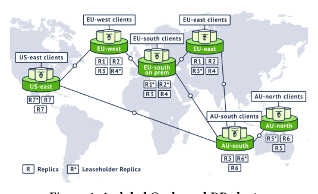
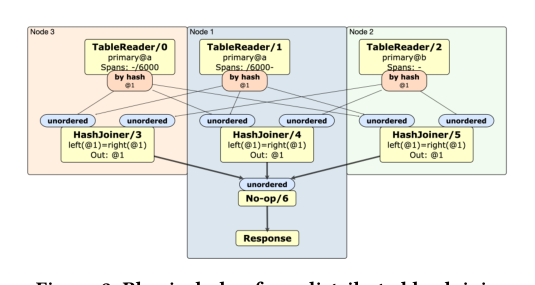

# cockroachdb-sigmod2020-resilient_geodistributed_sql_database

- Note for readers: text below is extracted per PDF page, delimited by
  `<!-- pdf page N -->` markers. Figure images embedded in the PDF are
  extracted under `cockroachdb-sigmod2020-resilient_geodistributed_sql_database.figures/` and linked at the top of the
  page they appear on, ordered top to bottom. Open an image file to see
  the figure; captions stay in the page text. Code listings and fine
  print may render imperfectly as text; fall back to the local PDF.

---

<!-- pdf page 1 -->

**Figures on page 1:**

SIGMOD ’20, June 14–19, 2020, Portland, OR, USA 

Industry 3: Cloud and Distributed Databases 

# **CockroachDB: The Resilient Geo-Distributed SQL Database** 

Rebecca Taft, Irfan Sharif, Andrei Matei, Nathan VanBenschoten, Jordan Lewis, Tobias Grieger, Kai Niemi, Andy Woods, Anne Birzin, Raphael Poss, Paul Bardea, Amruta Ranade, Ben Darnell, Bram Gruneir, Justin Jaffray, 

Lucy Zhang, and Peter Mattis 

sigmod2020@cockroachlabs.com 

Cockroach Labs, Inc. 

## **ABSTRACT** 

We live in an increasingly interconnected world, with many organizations operating across countries or even continents. To serve their global user base, organizations are replacing their legacy DBMSs with cloud-based systems capable of scaling OLTP workloads to millions of users. 

CockroachDB is a scalable SQL DBMS that was built from the ground up to support these global OLTP workloads while maintaining high availability and strong consistency. Just like its namesake, CockroachDB is resilient to disasters through replication and automatic recovery mechanisms. 

This paper presents the design of CockroachDB and its novel transaction model that supports consistent geo-distributed transactions on commodity hardware. We describe how CockroachDB replicates and distributes data to achieve fault tolerance and high performance, as well as how its distributed SQL layer automatically scales with the size of the database cluster while providing the standard SQL interface that users expect. Finally, we present a comprehensive performance evaluation and share a couple of case studies of CockroachDB users. We conclude by describing lessons learned while building CockroachDB over the last five years. 

### **ACM Reference Format:** 

Rebecca Taft, Irfan Sharif, Andrei Matei, Nathan VanBenschoten, Jordan Lewis, Tobias Grieger, Kai Niemi, Andy Woods, Anne Birzin, Raphael Poss, Paul Bardea, Amruta Ranade, Ben Darnell, Bram Gruneir, Justin Jaffray, Lucy Zhang, and Peter Mattis. 2020. CockroachDB: The Resilient Geo-Distributed SQL Database. In Proceedings of the 2020 ACM SIGMOD International Conference on Management of Data (SIGMOD’20), June 14ś19, 2020, Portland, OR, USA. 

<!-- Start of picture text -->
CC BY-SA <!-- End of picture text -->

This work is licensed under a Creative Commons Attribution-ShareAlike International 4.0 License. 

SIGMOD’20, June 14ś19, 2020, Portland, OR, USA © 2020 Copyright held by the owner/author(s). ACM ISBN 978-1-4503-6735-6/20/06. https://doi.org/10.1145/3318464.3386134 

<!-- Start of picture text -->
US-east (US-east clients): R7* R7 R7 EU-west (EU-west clients): R1 R2 R3 R4* EU-south on prem (EU-south clients): R1* R2* R3 R4 EU-east (EU-east clients): R1 R2 R3* R4 AU-north (AU-north clients): R5* R6 R5 AU-south (AU-south clients): R5 R6* R6 Legend: R = Replica, R* = Leaseholder Replica <!-- End of picture text -->

**Figure 1: A global CockroachDB cluster** 

ACM, New York, NY, USA, 17 pages. https://doi.org/10.1145/3318464. 3386134 

## **1 INTRODUCTION** 

Modern transaction processing workloads are increasingly geo-distributed. This trend is fueled by the desire of global companies to not only build scalable applications, but also control with fine-granularity where data resides for performance and regulatory reasons. 

Consider, for example, a large company with a core user base in Europe and Australia and a fast growing user base in the US. To power its global platform while reducing operational costs, the company has made the strategic decision to migrate to a cloud-based database management system (DBMS). It has the following requirements: to comply with the EU’s General Data Protection Regulation (GDPR), personal data for its European users must be domiciled within the EU. To avoid high latencies due to cross-continental communication, data should reside close to the users accessing it most frequently, and follow them (within regulatory limits) if they travel. Users expect an łalways onž experience, so the DBMS must be fault tolerant, even surviving a full regional failure. Finally, to avoid data anomalies and to simplify application development, the DBMS must support SQL with serializable transactions. 

1493 

<!-- pdf page 2 -->

SIGMOD ’20, June 14–19, 2020, Portland, OR, USA 

Industry 3: Cloud and Distributed Databases 

SIGMOD’20, June 14ś19, 2020, Portland, OR, USA 

CockroachDB (abbrev. CRDB) is a commercial DBMS designed to support all of the aforementioned requirements. As a case in point, the company described above is a real organization in the process of migrating their global platform to CRDB, and Fig. 1 shows the strategic vision for their CRDB deployment. In this paper, we present the design and implementation of CRDB and explain in detail the rationale for the decisions we made, as well as some lessons learned along the way. We explain how CRDB supports the requirements of global companies such as the one above by focusing on the following features: 

- (1) **Fault tolerance and high availability** To provide fault tolerance, CRDB maintains at least three replicas of every partition in the database across diverse geographic zones. It maintains high availability through automatic recovery mechanisms whenever a node fails. 

- (2) **Geo-distributed partitioning and replica placement** CRDB is horizontally scalable, automatically increasing capacity and migrating data as nodes are added. By default it uses a set of heuristics for data placement (see Section 2.2.3), but it also allows users to control, at a fine granularity, how data is partitioned across nodes and where replicas should be located. We will describe how users can use this feature for performance optimization or as part of a data domiciling strategy. 

- (3) **High-performance transactions** CRDB’s novel transaction protocol supports performant geo-distributed transactions that can span multiple partitions. It provides serializable isolation using no specialized hardware; a standard clock synchronization mechanism such as NTP is sufficient. As a result, CRDB can be run on off-the-shelf servers, including those of public and private clouds. 

CRDB is a production-grade system that was designed to łmake data easyž, so in addition to the above, CRDB supports the SQL standard with a state-of-the-art query optimizer and distributed SQL execution engine. It also includes all the features necessary for our users to run CRDB in production as a system of record, including online schema changes, backup and restore, fast imports, JSON support, and integration with external analytics systems. 

All of the source code of CRDB is available on GitHub [12]. The core features of the database are under a Business Source License (BSL), which converts to a fully open-source Apache 2.0 license after three years [13]. Additionally, CRDB is łcloudneutralž, meaning a single CRDB cluster can span an arbitrary number of different public and private clouds. These two features enable users to mitigate the risks of vendor lockin, such as reliance on proprietary extensions of SQL [6, 23] or exposure to cloud provider outages [70]. 

The remainder of the paper is organized as follows: In Section 2, we present an overview of CRDB, summarizing how 

R. Taft, I. Sharif, A. Matei, N. VanBenschoten, J. Lewis, T. Grieger et al. 

the database provides fault tolerance and high availability through replication and strategic data placement. Section 3 provides a deep-dive into CRDB’s transaction model. Section 4 explains how we use timestamp ordering to achieve strong consistency, even with loosely synchronized clocks on commodity hardware. Section 5 describes the SQL data model, planning, execution, and schema changes. Section 6 evaluates the performance of CRDB and contains two case studies of CRDB usage. Section 7 summarizes our lessons learned while building CRDB. Section 8 describes related work, and Section 9 presents conclusions and future work. 

# **2 SYSTEM OVERVIEW** 

This section begins with an overview of CRDB’s architecture in Section 2.1. Sections 2.2 and 2.3 describe how the system replicates and distributes data to provide fault tolerance, high availability, and geo-distributed partitioning. 

# **2.1 Architecture of CockroachDB** 

CRDB uses a standard shared-nothing [62] architecture, in which all nodes are used for both data storage and computation. A CRDB cluster consists of an arbitrary number of nodes, which may be colocated in the same datacenter or spread across the globe. Clients can connect to any node in the cluster. 

Within a single node, CRDB has a layered architecture. We now introduce each of the layers, including concepts and terminology used throughout the paper. 

2.1.1 SQL. At the highest level is the SQL layer, which is the interface for all user interactions with the database. It includes the parser, optimizer, and the SQL execution engine, which convert high-level SQL statements to low-level read and write requests to the underlying key-value (KV) store. 

In general, the SQL layer is not aware of how data is partitioned or distributed, because the layers below present the abstraction of a single, monolithic KV store. Section 5 will describe how certain queries break this abstraction, however, for more efficient distributed SQL computation. 

2.1.2 Transactional KV. Requests from the SQL layer are passed to the Transactional KV layer that ensures atomicity of changes spanning multiple KV pairs. It is also largely responsible for CRDB’s isolation guarantees. These atomicity and isolation guarantees will be described in detail in Sections 3 and 4. 

2.1.3 Distribution. This layer presents the abstraction of a monolithic logical key space ordered by key. All data is addressable within this key space, whether it be system data (used for internal data structures and metadata) or user data (SQL tables and indexes). 

CRDB uses range-partitioning on the keys to divide the data into contiguous ordered chunks of size ~64 MiB, that are stored across the cluster. We call these chunks łRangesž. 

1494 

<!-- pdf page 3 -->

SIGMOD ’20, June 14–19, 2020, Portland, OR, USA 

Industry 3: Cloud and Distributed Databases 

CockroachDB: The Resilient Geo-Distributed SQL Database 

Ordering between Ranges is maintained in a two-level indexing structure inside a set of system Ranges, which are cached aggressively for fast key lookups. The Distribution layer is responsible for identifying which Ranges should handle which subset of each query, and routes the subsets accordingly. 

Ranges are ~64 MiB because it is a size small enough to allow Ranges to quickly move between nodes but large enough to store a contiguous set of data likely to be accessed together. Ranges start empty, grow, split when they get too large, and merge when they get too small. Ranges also split based on load to reduce hotspots and imbalances in CPU usage. 

2.1.4 Replication. By default, each Range is replicated three ways, with each replica stored on a different node. In Section 2.2, we describe how the Replication layer ensures durability of modifications using consensus-based replication. 2.1.5 Storage. This is the bottommost level, and represents a local disk-backed KV store. It provides efficient writes and range scans to enable performant SQL execution. At the time of writing, we rely on RocksDB [54], which is welldocumented elsewhere, and which we treat as a black box throughout the paper. 

# **2.2 Fault Tolerance and High Availability** 

CRDB guarantees fault tolerance and high availability through replication of data (Section 2.2.1), automatic recovery mechanisms in case of failure (Section 2.2.2), and strategic data placement (Section 2.2.3). 

2.2.1 Replication using Raft. CRDB uses the Raft consensus algorithm [46] for consistent replication. Replicas of a Range form a Raft group, where each replica is either a long-lived leader coordinating all writes to the Raft group, or a follower. The unit of replication in CRDB is a command, which represents a sequence of low-level edits to be made to the storage engine. Raft maintains a consistent, ordered log of updates across a Range’s replicas, and each replica individually applies commands to the storage engine as Raft declares them to be committed to the Range’s log. 

CRDB uses Range-level leases, where a single replica in the Raft group (usually the Raft group leader) acts as the leaseholder. It is the only replica allowed to serve authoritative up-to-date reads or propose writes to the Raft group leader. Because all writes go through the leaseholder, reads can bypass networking round trips required by Raft without sacrificing consistency. Leases for user Ranges are tied to the liveness of the node the leaseholder is on; to signal liveness, nodes heartbeat a special record in a system Range every 4.5 seconds. System Ranges in turn use expiration based leases which must be renewed every 9 seconds. If a replica detects that the leaseholder is not live, it tries to acquire the lease. 

To ensure that only one replica holds a lease at a time, lease acquisitions piggyback on Raft; replicas attempting to acquire a lease do so by committing a special lease acquisition 

SIGMOD’20, June 14ś19, 2020, Portland, OR, USA 

log entry. To prevent two replicas from acquiring leases overlapping in time, lease acquisition requests include a copy of the lease believed to be valid at the time of request. As we will discuss in Section 4, ensuring disjoint leases is essential for CRDB’s isolation guarantees. 

2.2.2 Membership changes and automatic load (re)balancing. Nodes can be added to or removed from running CRDB clusters, and can fail temporarily or even permanently. CRDB treats all of these scenarios similarly: they all cause load to be redistributed across the new and/or remaining live nodes. 

For short-term failures, CRDB uses Raft to operate seamlessly as long as a majority of replicas remain available. Raft ensures the election of a new leader for the Raft group if the leader fails so that transactions can continue. Affected replicas can rejoin their group once back online, and peers help them catch up on missed updates by either (1) sending a snapshot of the full Range data, or (2) sending a set of missing Raft log entries to be applied. The method used is determined based on the number of writes that occurred while the replica was unavailable. 

For longer-term failures, CRDB automatically creates new replicas of under-replicated Ranges (using the unaffected replicas as sources), and determines placement as described in the next section. The node liveness data and cluster metrics required to make this determination are disseminated across the cluster using a peer-to-peer gossip protocol. 

2.2.3 Replica placement. CRDB has both manual and automatic mechanisms to control replica placement. 

To control placement manually, users configure individual nodes in CRDB with a set of attributes. These attributes may specify node capability (such as specialized hardware, RAM, disk type, etc.) and/or node locality (such as country, region, availability zone, etc.). When creating tables in the database, users can specify placement constraints and preferences as part of the schema of the table. For example, users may include a łregionž column in a table, which can be used to define the partitioning for the table and also map partitions to specific geographic regions. 

The other mechanism for replica placement is automatic: CRDB spreads replicas across failure domains (while adhering to the specified constraints and preferences), to tolerate varying severities of failure modes (disk, rack, data center, or region failures). CRDB also uses various heuristics to balance load and disk utilization. 

# **2.3 Data Placement Policies** 

CRDB’s replica and leaseholder placement mechanisms allow for a wide range of possible data placement policies that allow users to comply with data domiciling requirements and also make trade-offs between performance and fault tolerance. Some multi-region patterns we support are listed below. 

1495 

<!-- pdf page 4 -->

SIGMOD ’20, June 14–19, 2020, Portland, OR, USA 

Industry 3: Cloud and Distributed Databases 

SIGMOD’20, June 14ś19, 2020, Portland, OR, USA 

- **Geo-Partitioned Replicas** For data with geographic access locality, tables can be partitioned by access location with each partition (set of Ranges) pinned to a specific region. This makes for fast intra-region reads and intraregion writes, as well as survival of availability zone (AZ) failures. Region-wide failures result in unavailability for data localized to the region. This policy can also be used for enforcing data domiciling requirements. 

- **Geo-Partitioned Leaseholders** Leaseholders for partitions in a geo-partitioned table can be pinned to the region of access with the remaining replicas pinned to the remaining regions. This policy enables fast intra-region reads and survival of regional failures, but comes at a cost of slower cross-region writes. 

- **Duplicated Indexes** Like all other data in CRDB, Indexes are stored in Ranges that can be pinned to specific regions. By duplicating indexes on a table and pinning each index’s leaseholder to a specific region, the database can serve fast local reads while retaining the ability to survive regional failures. This comes with higher write amplification and slower cross-region writes, but is useful for data that is infrequently updated or cannot be tied to specific geographies. 

# **3 TRANSACTIONS** 

CRDB transactions can span the entire key space, touching data resident across a distributed cluster while providing ACID guarantees. CRDB uses a variation of multi-version concurrency control (MVCC) to provide serializable isolation. 

We begin by providing an overview of the transaction model in Section 3.1. Section 3.2 describes how we guarantee transactional atomicity. In Sections 3.3 and 3.4, we describe the concurrency control mechanisms that guarantee serializable isolation. Finally, Section 3.5 gives an overview of how follower replicas can serve consistent historical reads. 

# **3.1 Overview** 

A SQL transaction starts at the gateway node for the SQL connection. This node interactively receives from and responds to the SQL client and acts as the transaction coordinator (orchestrating and ultimately committing/aborting the associated transaction). Applications typically connect to a geographically close gateway to minimize latency. In the following subsection, we describe the coordinator algorithm. 3.1.1 Execution at the transaction coordinator. Algorithm 1 shows the high-level steps of the transaction from the perspective of the coordinator. Over the course of the transaction, the coordinator receives a series of requested KV operations from the SQL layer (Line 2). 

SQL requires that a response to the current operation must be returned before the next operation is issued. To avoid stalling the transaction while operations are being replicated, 

R. Taft, I. Sharif, A. Matei, N. VanBenschoten, J. Lewis, T. Grieger et al. 

## **Al** **<mark>g</mark> orithm 1:** Transaction Coordinator 

- **1** inflightOps ←∅, txnTimestamp ← now() 

|**2 f**|**or**op←KV operation received from SQL layer|
|---|---|
|**3** **4**|op.ts←txnTimestamp **if** op.commit|
|**5** **6**|op.deps←inflightOps **else**|
|**7**|op.deps←{x∈inflightOps | x.key=op.key}|
|**8**|inflightOps←(inflightOps −op.deps)∪{op}|
|**9**|resp←SendToLeaseholder(op)|
|**10**|**if** resp.ts>op.ts|
|**11**|**if** op.keyunchanged over(txnTimestamp,resp.ts]|
|**12**|txnTimestamp←resp.ts|
|**13**|**else**|
|**14**|return transaction failed|
|**15**|sendrespto SQL layer|
|**16**|**if** op.commit|
|**17**|asynchonously notify leaseholder to commit|

the coordinator employs two important optimizations: Write Pipelining and Parallel Commits. Write Pipelining allows returning a result without waiting for the replication of the current operation, and Parallel Commits lets the commit operation and the write pipeline replicate in parallel. Combined, they allow many multi-statement SQL transactions to complete with the latency of just one round of replication. 

To enable the aforementioned optimizations, the coordinator tracks operations which may not have fully replicated yet (Line 1). It also maintains the transaction timestamp, which is initialized to the current time but may move forward over the course of the transaction. Since CRDB uses MVCC, the timestamp selects the point at which the transaction performs its reads and writes (which, thereafter, are visible to other transactions). 

**Write Pipelining.** Each operation includes the key that must be read or updated, as well as metadata indicating if the transaction should commit with the current operation. In case an operation does not attempt to commit (Line 6), it’s possible to execute it immediately if it does not overlap any earlier operation (Line 7). In this way, multiple operations on different keys can be łpipelinedž. If an operation depends on an earlier in-flight operation, execution must wait for the earlier operation to be replicated; such dependencies introduce a łpipeline stallž. The pipelining logic is outlined in Algorithm 2 (discussed below), but relies on the dependencies calculated here. Additionally, the coordinator tracks the current operation as in-flight (Line 8). 

Next the coordinator sends the operation to the leaseholder for execution and waits for a response (Line 9). The response may contain an incremented timestamp (Line 10), which indicates that another transaction’s read forced the 

1496 

<!-- pdf page 5 -->

SIGMOD ’20, June 14–19, 2020, Portland, OR, USA 

Industry 3: Cloud and Distributed Databases 

CockroachDB: The Resilient Geo-Distributed SQL Database 

<!-- Start of picture text -->
P arallel Commit s T wo−Phase Commit 150 0 100 0 50 0 0 15 0 10 0 5 0 0 0 1 2 3 4 5 Number of Secondary Indexes (txns/ s) Throughput (ms) Latency <!-- End of picture text -->

**Figure 2: Performance impact of Parallel Commits** 

leaseholder to adjust the operation timestamp. The coordinator then tries to adjust the transaction timestamp to match. This is achieved by verifying (via a round of RPCs) that repeating the previous reads in the transaction at the new timestamp will return the same value (Lines 11 and 12). If not, the transaction fails (Lines 13 and 14) and may have to be retried. This mechanism is described in detail in Section 3.4. 

**Parallel Commits.** Now we consider what happens when the transaction wants to commit. Naively, it can only do so once all of its writes are known to have replicated, requiring at least two sequential rounds of consensus. Instead, the Parallel Commits protocol employs a staging transaction status which makes the true status of the transaction conditional on whether all of its writes have been replicated. This avoids the extra round of consensus because the coordinator is free to initiate the replication of the staging status in parallel with the verification of the outstanding writes, which are also being replicated (Line 5). Assuming both succeed, the coordinator can immediately acknowledge the transaction as committed to the SQL layer (Line 15). Before terminating, the coordinator asynchronously records the transaction status as being explicitly committed (Lines 16 and 17). This is done for performance reasons, and is discussed in Section 3.2, where we also explain how a staging record is resolved after an untimely crash of the coordinator. 

We formally verified the safety properties of Parallel Commits using TLA+ [36, 38]. Specifically we verified atomicity by asserting that every staging transaction was eventually either explicitly committed or aborted, regardless of coordinator failure, and no clients were told otherwise. We also verified durability by asserting that committed transactions stayed committed. The verification code is available on GitHub [14]. 

To demonstrate the benefits of Parallel Commits empirically, we run a microbenchmark on three servers spread across three regions. The workload consists of single-row writes to a table with ten columns and a variable number of secondary indexes on those columns. Fig. 2 shows that for this workload, Parallel Commits improves throughput by up to 72% and reduces p50 latency by up to 47% when 

SIGMOD’20, June 14ś19, 2020, Portland, OR, USA 

**Al** **<mark>g</mark> orithm 2:** Leaseholder 

|**1 F** **2**|**unction**Handle(op) verify lease|
|---|---|
|**3**|wait for latches on keys of{op} ∪op.deps|
|**4**|verify writes inop.depsare replicated|
|**5**|**if** opis not read-only|
|**6**|pushop.tspast highest read timestamp forop.key|
|**7**|command,response←evaluateop|
|**8**|response.ts←op.ts|
|**9**|**if** not op.commit**then**|
|**10**|sendresponseto coordinator|
|**11**|**if** opis not read-only|
|**12**|replicate and applycommand|
|**13**|release latches|
|**14**|**if** op.commit|
|**15**|sendresponseto coordinator|

the table has one or more secondary indexes, since index updates require multi-Range transactions. This shows that even as transactions require cross-Range coordination, their latency profiles remain constant. 

3.1.2 Execution at the leaseholder. When the leaseholder receives an operation from the coordinator (Algorithm 2), it first checks that its own lease is still valid (Line 2). Then it acquires latches on the keys of op and all the operations op depends on (Line 3), thus providing mutual exclusion between concurrent, overlapping requests. Next it verifies that the operations op depends on have succeeded (Line 4). If it is performing a write, it also ensures that the timestamp of op is after any conflicting readers, incrementing it if necessary (Lines 5 and 6), so as not to invalidate those transactions. 

Once the initial checks are complete, the leaseholder evaluates the operation to determine what data modifications are needed in the storage engine without actually making the changes (Line 7). This results in a low level command detailing the necessary changes, as well as a response for the client (e.g., success in case of a write, or the value in case of a read). If this operation is not committing the transaction, the leaseholder can respond to the coordinator without waiting for replication (Lines 9 and 10). Write operations are then replicated. After consensus is reached, each replica applies the command to its local storage engine (Lines 11 and 12). Finally, the leaseholder releases its latches and responds to the coordinator if it hasn’t already done so (Lines 13 to 15). 

Note that Algorithm 2 does not delve into any details about the various scenarios that may occur during the evaluation phase (Line 7). This is the period of time when a transaction may encounter uncommitted writes from other transactions or writes so close in time to the transaction’s read timestamp that it is not possible to determine the correct order of transactions. The next sections discuss these scenarios, and how CRDB guarantees both atomicity and serializable isolation. 

1497 

<!-- pdf page 6 -->

SIGMOD ’20, June 14–19, 2020, Portland, OR, USA 

Industry 3: Cloud and Distributed Databases 

SIGMOD’20, June 14ś19, 2020, Portland, OR, USA 

# **3.2 Atomicity Guarantees** 

An atomic commit for a transaction is achieved by considering all of its writes provisional until commit time. CRDB calls these provisional values write intents. An intent is a regular MVCC KV pair, except that it is preceded by metadata indicating that what follows is an intent. This metadata points to a transaction record, which is a special key (unique per transaction) that stores the current disposition of the transaction: pending, staging, committed or aborted. The transaction record serves to atomically change the visibility of all the intents at once, and is durably stored in the same Range as the first write of the transaction (see Section 3.1 for the protocol details). For long-running transactions, the coordinator periodically heartbeats the transaction record in the pending state to assure contending transactions that it is still making progress. 

Upon encountering an intent, a reader follows the indirection and reads the intent’s transaction record. If the record indicates that the transaction is committed, the reader considers the intent as a regular value (and additionally deletes the intent metadata). If the transaction is aborted, the intent is ignored (and cleanup is performed to remove it). If the transaction is found to be pending (indicating that the transaction is still ongoing), then the reader blocks, waiting for it to finalize. If the coordinator node fails, contending transactions eventually detect that the transaction record has expired, and mark it aborted. If the transaction is in the staging state (which indicates that the transaction has either been committed or aborted, but the reader is unsure which), the reader attempts to abort the transaction by preventing one of its writes from being replicated. If all writes are already replicated, the transaction is in fact committed, and is updated to reflect that. 

# **3.3 Concurrency Control** 

As discussed in Section 3.1, CRDB is an MVCC system and each transaction performs its reads and writes at its commit timestamp. This results in a total ordering of all transactions in the system, representing a serializable execution. 

However, conflicts between transactions may require adjustments of the commit timestamp. We describe the situations in which they arise below, and note that whenever the commit timestamp does change, the transaction typically tries to prove that its prior reads remain valid at the new timestamp (Section 3.4), in which case it can simply continue forward at the updated timestamp. 

3.3.1 Write-read conflicts. A read running into an uncommitted intent with a lower timestamp will wait for the earlier transaction to finalize. Waiting is implemented using in-memory queue structures. A read running into an uncommitted intent with a higher timestamp ignores the intent and does not need to wait. 

R. Taft, I. Sharif, A. Matei, N. VanBenschoten, J. Lewis, T. Grieger et al. 

3.3.2 Read-write conflicts. A write to a key at timestamp ta cannot be performed if there’s already been a read on the same key at a higher timestamp tb >= ta. CRDB forces the writing transaction to advance its commit timestamp past tb . 3.3.3 Write-write conflicts. A write running into an uncommitted intent with a lower timestamp will wait for the earlier transaction to finalize (similar to write-read conflicts). If it runs into a committed value at a higher timestamp, it advances its timestamp past it (similar to read-write conflicts). Write-write conflicts may also lead to deadlocks in cases where different transactions have written intents in different orders. CRDB employs a distributed deadlock-detection algorithm to abort one transaction from a cycle of waiters. 

# **3.4 Read Refreshes** 

Certain types of conflicts described above require advancing the commit timestamp of a transaction. To maintain serializability, the read timestamp must be advanced to match the commit timestamp. 

Advancing a transaction’s read timestamp from ta to tb > ta is possible if we can prove that none of the data that the transaction read at ta has been updated in the interval (ta, tb ]. If the data has changed, the transaction needs to be restarted. If no results from the transaction have been delivered to the client, CRDB retries the transaction internally1 . If results have been delivered, the client is informed to discard them and restart the transaction. 

To determine whether the read timestamp can be advanced, CRDB maintains the set of keys in the transaction’s read set (up to a memory budget). A łread refreshž request validates that the keys have not been updated in a given timestamp interval (Algorithm 1, Lines 11 to 14). This involves re-scanning the read set and checking whether any MVCC values fall in the given interval. This process is equivalent to detecting the rw-antidependencies that PostgreSQL tracks for its implementation of SSI [8, 49]. Similar to PostgreSQL, our implementation may allow false positives (forcing a transaction to abort when not strictly necessary) to avoid the overhead of maintaining a full dependency graph. 

Advancing the transaction’s read timestamp is also required when a scan encounters an uncertain value: a value whose timestamp makes it unclear if it falls in the reader’s past or future (see Section 4.2). In this case we also attempt to perform a refresh. Assuming it is successful, the value will now be returned by the read. 

# **3.5 Follower Reads** 

CRDB allows non-leaseholder replicas to serve requests for read-only queries with timestamps sufficiently in the 

> 1CRDB increases the likelihood that a restarted transaction will succeed by deferring the restart so the original transaction can first place write locks (in the form of write intents) on the keys it intends to write to. 

1498 

<!-- pdf page 7 -->

SIGMOD ’20, June 14–19, 2020, Portland, OR, USA 

Industry 3: Cloud and Distributed Databases 

CockroachDB: The Resilient Geo-Distributed SQL Database 

past through a special ‘AS OF SYSTEM TIME’ query modifier. To enable this functionality safely, a non-leaseholder replica asked to perform a read at a given timestampT needs to know that no future writes can invalidate the read retroactively. It also needs to ensure that it has all the data necessary to serve the read. These conditions mean that if a follower read at timestamp T is to be served, the leaseholder must no longer be accepting writes for timestamps T′ ≤ T , and the follower must have caught up on the prefix of the Raft log affecting the MVCC snapshot at T . 

To this end, each leaseholder tracks the timestamps of all incoming requests and periodically emits a closed timestamp, the timestamp below which no further writes will be accepted. Closed timestamps, alongside Raft log indexes at the time, are exchanged periodically between replicas. Follower replicas use the state built up from received updates to determine if they have all the data needed to serve consistent reads at a given timestamp. For efficiency reasons the closed timestamp and the corresponding log indexes are generated at the node level (as opposed to the Range level). 

Every node keeps a record of its latency with all other nodes in the system. When a node in the cluster receives a read request at a sufficiently old timestamp (closed timestamps typically trail current time by ~2 seconds), it forwards the request to the closest node with a replica of the data. 

# **4 CLOCK SYNCHRONIZATION** 

CRDB does not rely on specialized hardware for clock synchronization, so it can run on off-the-shelf servers in public and private clouds with software-level clock synchronization services such as NTP or Amazon Time Sync Service. 

In this section, we introduce the hybrid-logical clock scheme CRDB uses to talk about timestamp ordering (Section 4.1). We then discuss how this clock scheme allows loosely synchronized clocks to efficiently provide single-key linearizability between transactions (Section 4.2). Finally, we explore the behavior of CRDB when configurable clock synchronization bounds are violated (Section 4.3). 

# **4.1 Hybrid-Logical Clocks** 

Each node within a CRDB cluster maintains a hybridlogical clock (HLC) [20], which provides timestamps that are a combination of physical and logical time. Physical time is based on a node’s coarsely-synchronized system clock, and logical time is based on Lamport’s clocks [37]. 

HLCs within a CRDB deployment are configured with a maximum allowable offset between their physical time component and that of other HLCs in the cluster. This offset configuration defaults to a conservative value of 500 ms. Hybrid-logical clocks provide a few important properties: 

- (1) HLCs provide **causality tracking** through their logical component upon each inter-node exchange. Nodes attach 

SIGMOD’20, June 14ś19, 2020, Portland, OR, USA 

HLC timestamps to each message that they send and use HLC timestamps from each message that they receive to update their local clock. 

Capturing causal relationships between events on different nodes is critical for enforcing invariants within CRDB. The most important of these is a lease disjointness invariant similar to that in Spanner: for each Range, each lease interval is disjoint from every other lease interval. This is enforced on cooperative lease handoff with causality transfer through the HLC and is enforced on non-cooperative lease acquisition through a delay equal to the maximum clock offset between lease intervals. 

- (2) HLCs provide **strict monotonicity** within and across restarts on a single node. Within a continuous process, providing this property is trivial. Across restarts, this property is enforced by waiting out the maximum clock offset upon process startup before serving any requests. Strictly monotonic timestamp allocation ensures that 

- two causally dependent transactions originating from the same node are given timestamps that reflect their ordering in real time. 

- (3) HLCs provide **self-stabilization** in the presence of isolated transient clock skew fluctuations. As stated above, a node forwards its HLC upon its receipt of a network message. The effect of this is that given sufficient intra-cluster communication, HLCs across nodes tend to converge and stabilize even if their individual physical clocks diverge. This provides no strong guarantees but can mask clock synchronization errors in practice. 

# **4.2 Uncertainty Intervals** 

We have already discussed how the transaction model in CRDB provides serializable isolation between transactions. However, serializability on its own says nothing about how transaction ordering in the system relates to the ordering in real time. For that, we must talk about the consistency level that CRDB offers. 

Under normal conditions, CRDB satisfies single-key linearizability for reads and writes. This means that every operation on a given key appears to take place atomically and in some total linear order consistent with the real-time ordering of those operations. Under single-key linearizability, stale read anomalies are not possible. This is true even with loosely synchronized clocks, as long as those clocks stay within the configured maximum clock offset from one another. 

Note that CRDB does not support strict serializability because there is no guarantee that the ordering of transactions touching disjoint key sets will match their ordering in real time. In practice, this is not a problem for applications unless there is an external low-latency communication channel between clients that could potentially impact activity on the DBMS. 

1499 

<!-- pdf page 8 -->

SIGMOD ’20, June 14–19, 2020, Portland, OR, USA 

Industry 3: Cloud and Distributed Databases 

SIGMOD’20, June 14ś19, 2020, Portland, OR, USA 

The single-key linearizability property is satisfied in CRDB by tracking an uncertainty interval for each transaction, within which the causal ordering between two transactions is indeterminate. Upon its creation, a transaction is given a provisional commit timestamp commit_ts from the transaction coordinator’s local HLC and an uncertainty interval of [commit_ts, commit_ts + max_offset]. 

When a transaction encounters a value on a key at a timestamp below its provisional commit timestamp, it trivially observes the value during reads and overwrites the value at a higher timestamp during writes. This alone would satisfy single-key linearizability if transactions had access to a perfectly synchronized global clock. 

Without global synchronization, the uncertainty interval is needed because it is possible for a transaction to receive a provisional commit timestamp up to the cluster’s max_offset earlier than a transaction that causally preceded this new transaction in real time. When a transaction encounters a value on a key at a timestamp above its provisional commit timestamp but within its uncertainty interval, it performs an uncertainty restart, moving its provisional commit timestamp above the uncertain value but keeping the upper bound of its uncertainty interval fixed. 

This corresponds to treating all values in a transaction’s uncertainty window as past writes. As a result, the operations on each key performed by transactions take place in an order consistent with the real time ordering of those transactions. 

# **4.3 Behavior under Clock Skew** 

To this point, we have only considered the behavior of CRDB when the configured maximum clock offset bounds are respected. It is worth also considering the behavior of the system when these clock offset bounds are violated. 

Within a single Range, consistency is maintained through Raft. Raft does not have a clock dependency, so the ordering of changes it constructs for a single Range will remain linearizable regardless of clock skew. If all reads and writes were written to the Raft log, this would be enough to ensure consistency under arbitrary clock skew. However, Range leases allow reads to be served from a leaseholder without going through Raft. This causes complications because under sufficient clock skew, it is possible for multiple nodes to think they each hold the lease for a given Range. Without extra protection, this could lead to conflicting operations being permitted on the two leaseholders, resulting in client-visible isolation anomalies. 

CRDB employs two safeguards to ensure that such situations do not affect transaction isolation. 

- (1) Range leases contain a start and an end timestamp. A leaseholder cannot serve reads for MVCC timestamps above its lease interval or writes for MVCC timestamps outside its lease interval. The lease disjointness invariant 

R. Taft, I. Sharif, A. Matei, N. VanBenschoten, J. Lewis, T. Grieger et al. 

discussed earlier ensures that within a Range, each lease interval is disjoint from every other lease interval. 

- (2) Each write to a Range’s Raft log includes the sequence number of the Range lease that it was proposed under. Upon successful replication, the sequence number is checked against the currently active lease. If they do not match, the write is rejected. Because lease changes for a Range are themselves written to the Range’s Raft log, only a single leaseholder is ever able to make changes to a Range at a time. This is true even if multiple nodes believe they hold a valid lease simultaneously. 

These two safeguards ensure that a pair of leaseholders that are active concurrently cannot serve requests that would violate serializable isolation. The first safeguard ensures that an incoming leaseholder cannot serve a write that invalidates a read served by an outgoing leaseholder. The second safeguard ensures that an outgoing leaseholder cannot serve a write that invalidates a read or a write served by an incoming leaseholder. Together, these safeguards ensure that even under severe clock skew that violates maximum clock offset bounds, CRDB provides serializable isolation. 

While isolation is maintained regardless of clock skew, clock skew outside of the configured clock offset bounds can result in violations of single-key linearizability between causally-dependent transactions. This is possible if the transactions are issued through different gateway nodes whose clocks are skewed by more than the clock offset bounds. If the gateway node for the second transaction is assigned a commit_ts more than max_offset below the timestamp of the first transaction, it is possible for values written by the first transaction to be outside of the uncertainty interval of the second. This would allow the second transaction to read keys overlapping the write set of the first without actually observing the writes. Stale reads represent a violation of single-key linearizability and are only prevented when clocks remain within offset bounds. 

To reduce the likelihood of stale reads, nodes periodically measure their clock’s offset from other nodes. If any node exceeds the configured maximum offset by more than 80% compared to a majority of other nodes, it self-terminates. 

# **5 SQL** 

So far we have discussed the technical details of the Transactional KV layer and layers below, but all user interaction with the database passes through the SQL layer. CRDB supports much of the PostgreSQL dialect of ANSI standard SQL [51] with some extensions (e.g., needed to support the geo-distributed nature of the database). 

This section describes the SQL data model and how it maps to the layers below (Section 5.1), the technical details of SQL planning and execution (Sections 5.2 and 5.3), and schema changes (Section 5.4). 

1500 

<!-- pdf page 9 -->

**Figures on page 9:**

SIGMOD ’20, June 14–19, 2020, Portland, OR, USA 

Industry 3: Cloud and Distributed Databases 

CockroachDB: The Resilient Geo-Distributed SQL Database 

# **5.1 SQL Data Model** 

Every SQL table and index is stored in one or more Ranges, as described in Section 2.1. Furthermore, all user data is stored in one or more ordered indexes, of which one is designated as the łprimaryž index. The primary index is keyed on the primary key, and all other columns are stored in the value (primary keys are automatically generated if not explicitly specified by the schema). Secondary indexes are keyed on the index key, and store the primary key columns as well as any number of additional columns specified by the index schema. CRDB also supports hash indexes, which can help avoid hot spots by distributing load across multiple Ranges. 

# **5.2 Query Optimizer** 

SQL query planning is performed by a Cascades-style [27] query optimizer that uses over 200 transformation rules to explore the space of possible query execution plans. 

5.2.1 Optgen, a DSL for query transformations. Transformation rules in CRDB are written in a domain-specific language (DSL) called Optgen that provides an intuitive syntax for defining, matching, and replacing operators in a query plan tree. Optgen compiles to Go so that the transformation rules can integrate seamlessly with the rest of the CRDB codebase (all of CRDB, with the exception of the storage layer, is implemented in Go). 

For example, consider a simple Optgen rule EliminateNot: 

[ EliminateNot , Normalize ] ( Not ( Not $input : ∗) ) => $input 

It matches scalar expressions containing two nested NOT operators, and replaces them with the input to the inner NOT. Transformation rules for relational expressions are more complex (e.g. they can call out to arbitrary Go methods), but all have the same structure with a łmatch patternž and a logically equivalent łreplace patternž separated by an arrow. 

EliminateNot is an example of a Normalization (rewrite) rule, in which the source expression is replaced with the transformed expression. Exploration rules (such as join reordering and join algorithm selection) preserve both expressions so that the optimizer can select whichever one has a lower estimated cost. Consistent with the Cascades model, CRDB’s optimizer uses a unified search in which application of Normalization and Exploration rules are interleaved. The generated code ensures that minimal memory is allocated for an operator until all applicable normalization rules have been applied. 

5.2.2 Optimizer is distribution-aware. Many of CRDB’s transformation rules can be found in other state-of-the-art query optimizers, but some are specific to the geo-distributed and partitioned nature of CRDB. For example, the optimizer can use information about a table’s partitioning to infer additional filters and enable more selective index scans. Consider 

SIGMOD’20, June 14ś19, 2020, Portland, OR, USA 

<!-- Start of picture text -->
Node 3: TableReader/0 (primary@a, Spans: -/6000, output by hash @1) → HashJoiner/3 (left(@1)=right(@1), Out: @1) Node 1: TableReader/1 (primary@a, Spans: /6000-, output by hash @1) → HashJoiner/4 (left(@1)=right(@1), Out: @1) Node 2: TableReader/2 (primary@b, Spans: -, output by hash @1) → HashJoiner/5 (left(@1)=right(@1), Out: @1) Each TableReader sends rows by hash on @1 to all three HashJoiners. Each HashJoiner has two unordered inputs: left from TableReader/0 and TableReader/1 (table a), right from TableReader/2 (table b). Node 1: HashJoiner/3, HashJoiner/4, HashJoiner/5 → No-op/6 (unordered input) → Response <!-- End of picture text -->

**Figure 3: Physical plan for a distributed hash join** 

an index idx(region, id) on a table t partitioned across two regions, east and west. In this case, the query SELECT * FROM t WHERE id = 5 can be rewritten as SELECT * FROM t WHERE id = 5 AND (region = ’east’ OR region = ’west’), thus enabling use of the index. This is similar to Oracle’s index skip scan [29], but filters are determined statically from the schema rather than from histograms. 

The optimizer also takes data distribution into account as part of its cost model. For some workloads, it may be beneficial to replicate a secondary index such that each region has its own copy (see Duplicated Indexes in Section 2.3). The optimizer minimizes cross-region data shuffling by assigning a cost to each index replica based on how close it is to the gateway node of a query. 

# **5.3 Query Planning and Execution** 

SQL query execution in CRDB is executed in one of two modes: (1) gateway-only mode, in which the node that planned the query is responsible for all SQL processing for the query, or (2) distributed mode, in which other nodes in the cluster participate in SQL processing. At the time of writing, only read-only queries can execute in distributed mode. 

Since the Distribution layer presents the abstraction of a single, monolithic key space, the SQL layer can perform read and write operations for any Range on any node. This allows SQL operators to behave identically whether planned in gateway-only or distributed mode. 

The decision to distribute is made by a heuristic estimating the quantity of data that would need to be sent over the network. Queries that only read a small number of rows are executed in gateway-only mode. To produce a distributed query plan when necessary, CRDB performs a physical planning stage that transforms the query optimizer’s plan into a directed acyclic graph (DAG) of physical SQL operators. 

Physical planning splits logical scan operations into multiple TableReader operators, one for each node containing a Range read by the scan. Once the scans are segmented, the remaining logical operators are scheduled on the same nodes as the TableReaders, thus pushing down filters, joins, and aggregations as close to the physical data as possible. 

1501 

<!-- pdf page 10 -->

SIGMOD ’20, June 14–19, 2020, Portland, OR, USA 

Industry 3: Cloud and Distributed Databases 

SIGMOD’20, June 14ś19, 2020, Portland, OR, USA 

Fig. 3 shows an example of a distributed hash join across the primary indexes of two tables, a and b, on a 3 node cluster in which node 2 holds the requested Ranges of b, but the Ranges of a are split between nodes 1 and 3. The scanned data is shuffled by hash to all nodes involved in the scan, joined with a node-local hash join operator, and sent back to the gateway node, which unions the results and returns them to the SQL client. This kind of figure can be produced by the database for any query using the EXPLAIN(distsql) command on the query. 

Within a data stream, CRDB uses one of two different execution engines depending on input cardinality and plan complexity: a row-at-a-time engine or a vectorized engine. 

5.3.1 Row-at-a-time execution engine. CRDB’s primary execution engine is based on the Volcano [26] iterator model and processes a single row at a time. Every supported SQL feature in CRDB is implemented in this execution engine, including joins, aggregations, sorts, window functions, etc. 

5.3.2 Vectorized execution engine. CRDB can execute a subset of SQL queries using a vectorized execution engine that was inspired by MonetDB/X100 [7]. The vectorized engine operates on column-oriented batches of data instead of rows. 

If the vectorized engine is chosen, data from disk is transposed from row to column format as it is being read from CRDB’s KV layer, and transposed again from column to row format right before it is sent back to the end user. The overhead of this process is minimal. 

In contrast to the row-at-a-time engine, operators implemented in the vectorized engine are monomorphized on all SQL data types that they support to drastically reduce the interpreter overhead inherent in the row-at-a-time iterator model. Since CRDB is written in Go, which does not support generics with specialization, this monomorphization is done using templated code generation. 

All of CRDB’s vectorized operators can handle the presence of a selection vector, a tightly-packed array of indices into the data columns that have not yet been filtered out by previous operators. The selection vector is used to avoid expensive physical removal of data after selection operators. Complex operators such as merge joins use monomorphization to generate multiple inner loops depending on whether a selection vector is present or not. 

The optimizations described above result in a speedup of over two orders of magnitude for individual operators, and up to 4x on queries in the TPC-H [69] benchmark. 

# **5.4 Schema Changes** 

CRDB performs schema changes, such as the addition of columns or secondary indexes, using a protocol that allows tables to remain online (i.e., able to serve reads and writes) during the schema change, and allows different nodes to 

R. Taft, I. Sharif, A. Matei, N. VanBenschoten, J. Lewis, T. Grieger et al. 

<!-- Start of picture text -->
● O LTP Insert s O LTP Point Selects 500 0 Vertical Scalin g Horizontal Scalin g 400 0 300 0 200 0 100 0 ● ● ● ● ● ● ● ● ● 0 6 12 24 48 108 216 432 864 1728 vCPUs (log scale) (txns/ s/ vCPU) Throughput per vCPU <!-- End of picture text -->

**Figure 4: Maximum throughput per vCPU for Sysbench workloads with varying number of vCPUs** 

asynchronously transition to a new table schema at different times. 

CRDB implements the solution used by F1 [52] by following a protocol that decomposes each schema change into a sequence of incremental changes. In this protocol, the addition of a secondary index requires two intermediate schema versions between the initial and final ones to ensure that the index is being updated on writes across the entire cluster before it becomes available for reads. If we enforce the invariant that there are at most two successive versions of a schema used in the cluster at all times, then the database will remain in a consistent state throughout the schema change. 

# **6 EVALUATION** 

This section evaluates the performance of CRDB along a number of axes. We begin by examining the scalability of CRDB with various workload characteristics (Section 6.1). We follow with a study of CRDB’s performance in a multiregion deployment under various disaster scenarios (Section 6.2). Next, we compare the performance of CRDB to Spanner (Section 6.3). We conclude with several examples of external CRDB usage (Section 6.4). Unless otherwise noted, we use CRDB v19.2.2 in all experiments. 

# **6.1 Scalability of CockroachDB** 

6.1.1 Vertical and horizontal scalability. We evaluate the vertical and horizontal scalability of CRDB on łembarrassingly parallelž workloads by running two benchmarks from the Sysbench OLTP suite [33]. Fig. 4 shows that throughput per vCPU (for both reads and writes) stays nearly constant as the number of vCPUs increases. The left-hand side of the chart demonstrates vertical scalability, with experiments run on a three node cluster with varying AWS instance types (c5d.large, c5d.xlarge, c5d.2xlarge, c5d.4xlarge, and c5d.9xlarge with 2, 4, 8, 16, and 36 vCPUs respectively). The right-hand side of the chart demonstrates horizontal scalability, with experiments run on c5d.9xlarge instances with the cluster size varying from 3 to 48 nodes. All clusters span three AZs in us-east-1, and each point represents the average over three runs. Each experiment uses 4 tables per node and 1,000,000 rows per table, resulting in ~38 GB of data on the 48 node cluster. 

1502 

<!-- pdf page 11 -->

SIGMOD ’20, June 14–19, 2020, Portland, OR, USA 

Industry 3: Cloud and Distributed Databases 

SIGMOD’20, June 14ś19, 2020, Portland, OR, USA 

CockroachDB: The Resilient Geo-Distributed SQL Database 

||Replication Factor|● 1 3 5 Perc New|entage of Remote Order Transactions 0% 10% 100%|
|---|---|---|---|
|Maximum tpmC|**●** ● ● ● ● 0 25,000 50,000 75,000 100,000|● ● ●|● ● ●|
||1 3 6 12|24 Nod|48 es|
|**ig** **ra**|**ure 5: Maximum ** **nsactions, cluster**|**tpmC wit** **sizes, and**|**h varying % of remote** **replication factors** **Warehouses**|
|||**1,000**|**10,000** **100,000**|
||**CockroachDB** |||
||Max tpmC|12,474|124,036 1,245,462|
|fi|Efficiency|97.0%|96.5% 98.8%|
||NewOrderp90 latency|39.8 ms|436.2 ms 486.5 ms|
||Machine type(AWS)|c5d.4xlarge|c5d.4xlarge c5d.9xlarge|
||Node count|3|15 81|
||**Amazon Aurora [55]**|||
||Max tpmC|12,582|9,406 -|
|fi|Efficiency|97.8%|7.3% -|
||Latency, machine type, a|nd node count|not reported|

**Figure 5: Maximum tpmC with varying % of remote transactions, cluster sizes, and replication factors** 

**Table 1: TPC-C benchmark environment and results** 

6.1.2 Scalability with cross-node coordination. To evaluate the scalability of CRDB with varying amounts of cross-node coordination, we run TPC-C [68] with a variable percentage of remote warehouses in New Order transactions. Since replication also causes cross-node coordination, we additionally vary the replication factor. Fig. 5 shows that in these experiments, the overhead of replication can reduce throughput by up to 48% for three replicas or 57% for five replicas, and distributed transactions may further reduce throughput by up to 46%. Despite these overheads, all workloads scale linearly with increasing cluster sizes. This experiment uses n1-standard-4 GCP machines [25] (4 vCPUs each). Each point represents the average over three runs, where each run finds the maximum tpmC sustained for at least ten minutes. Since throughput in TPC-C scales with data size, the largest experiments shown here use 10,000 warehouses, corresponding to 800 GB of data. 

6.1.3 TPC-C performance comparison with Amazon Aurora. To demonstrate scalability on an industry-standard benchmark, we run TPC-C with 1,000, 10,000 and 100,000 warehouses on CRDB v19.2.0. As shown in Table 1, CRDB scales to support up to 100,000 warehouses, corresponding to 50 billion rows and 8 TB of data, at near-maximum efficiency. All experiments comply with the TPC-C spec (including wait times and the use of foreign keys). 

<!-- Start of picture text -->
G eo−Part. Leaseholder s G eo−Part. Replicas w/ Dup. Index G eo−Part. Replicas U npartitioned 1200 0 900 0 600 0 800 0 200 0 50 0 0 20 40 60 Elapsed time (minutes) tpmC p90 Latency (ms, log scale) <!-- End of picture text -->

**Figure 6: Multi-region cluster performance with various placement policies and AZ/region failures** 

Amazon Aurora is a commercial database for OLTP workloads that is also designed to be scalable and fault tolerant [72]. In contrast to CRDB, single-master Aurora only achieves 7.3% efficiency with 10,000 warehouses [55]. AWS has not published TPC-C numbers for multi-master Aurora [3]. 

# **6.2 Multi-region Availability and Performance** 

To illustrate the trade-offs made between performance and fault tolerance by different data placement policies (Section 2.3), we measure TPC-C 1,000 performance against a multi-region CRDB cluster as we induce AZ and region failures. This experiment uses 9 n1-standard-4 GCP machines deployed across three regions in the US, in addition to workload generators per region. 

The periods between the dashed lines in Fig. 6 represent, in order, an AZ failure and recovery, and a region-wide failure and recovery. On failure, requests are routed to fallback AZs (either in the same region or another, depending on the policy). Tables and indexes are partitioned by warehouse for partitioned policies. For the duplicated indexes policy, the read-only items table is replicated to every region. 

We verify that all policies are able to tolerate AZ failures. The slight performance degradation during an AZ failure is due to the remaining AZs being overloaded. Of the four policies, only geo-partitioned leaseholders is tolerant to region-wide failures. This translates to a higher sustained throughput during region-wide failures, but comes at a cost of higher p90 latencies during stable operation and recovery (compared to the geo-partitioned replicas variants). The slower recovery period is due to the primary region catching up on missed writes. The performance degradation during region failures, depending on the policy, can be attributed to either blocked remote warehouse transactions, or clients having to cross region boundaries to issue queries. Under stable conditions, the duplicated indexes policy maintains the lowest p90 latencies. 

1503 

<!-- pdf page 12 -->

SIGMOD ’20, June 14–19, 2020, Portland, OR, USA 

Industry 3: Cloud and Distributed Databases 

SIGMOD’20, June 14ś19, 2020, Portland, OR, USA 

<!-- Start of picture text -->
CRDB 4 vCPUs CRDB 16 vCPUs Average CRDB 8 vCPUs Spanner 95th Percentile 60,00 0 99th Percentile 40,00 0 Reads Updates 20,00 0 1 0 0 8 6 200,00 0 4 100,00 0 2 0 0 A B C D E F YCSB Workload CRDBSpannerCRDBSpanner 3 Servers Latency (ms) Throughput (txns/ s) 15 Servers <!-- End of picture text -->

**Figure 7: Throughput of CRDB and Spanner on YCSB A-F, Latency of CRDB and Spanner under light load** 

# **6.3 Comparison with Spanner** 

Fig. 7 compares CRDB’s performance against Cloud Spanner’s on the YCSB [16] benchmark suite2 . As Spanner is a managed service, it does not reveal its hardware configuration. We therefore compare against several CRDB configurations (4, 8 and 16 vCPUs per node). For reference, three n2-standard-8 GCP VMs (8 vCPUs each) with local storage cost within 0.2% of a one łnodež Spanner instance (consisting of three replicas). In all tests, replicas are spread across three AZs in a single region. 

For most YSCB workloads, CRDB shows significantly higher throughput. Both systems demonstrate horizontal scalability as the cluster size increases. One exception is Workload A (update-heavy, zipfian distribution of keys), on which CRDB does not scale well because of the workload’s high contention profile3 . We also include a test of the latency of reads and writes performed by YCSB under light load. CRDB shows significantly lower latencies at all percentiles, which we attribute in part to Spanner’s commit-wait. Latency results under heavy load are noisy but show a similar trend, so we omit them due to space constraints. 

# **6.4 Usage Case Studies** 

CRDB is used by thousands of organizations. In this section we outline two specific case studies of CRDB usage. 

6.4.1 Virtual customer support agent for a telecom provider. A US-based telecom provider wanted to reduce its customer service costs by building a virtual agent to provide 24/7 support to their customers. The agent relied on recording customer conversation metadata in a sessions database. The team chose CRDB for this system due to its strong consistency, regional failure tolerance, and performance for geodistributed clusters. 

For financial reasons, the team deployed a multi-region CRDB cluster split across their own on-prem data center and AWS regions. CRDB’s support for hybrid deployments 

> 2We use the official YCSB generator[76] with Spanner and JDBC clients. 

> 3We expect significant improvement for such workloads with optional read locking upcoming in the 20.1 release. 

R. Taft, I. Sharif, A. Matei, N. VanBenschoten, J. Lewis, T. Grieger et al. 

made this feasible. To survive regional failure, they opted for the geo-partitioned leaseholders policy. Writes would need to cross region boundaries to achieve quorum, but read performance would be local. 

6.4.2 Global platform for an online gaming company. An online gaming company processing 30-40 million financial transactions per day was looking for a database for their global platform. They had strict requirements on data compliance, consistency, performance and service availability. With their core user base in Europe and Australia, and a fast growing user base in the US, they sought to isolate failure domains and pin user data to specific localities for compliance and low latencies. 

CRDB’s architecture was a good fit for their requirements, and is now a strategic component in their long term roadmap. Fig. 1 shows the vision for their CRDB deployment. 

# **7 LESSONS LEARNED** 

This section details some lessons learned over the last five years of building CRDB and hardening it as a productiongrade system. 

# **7.1 Raft Made Live** 

We initially chose Raft as the consensus algorithm for CRDB due to its supposed ease of use and the precise description of its implementation [46]. In practice, we have found there are several challenges in using Raft in a complex system like CRDB. 

7.1.1 Reducing the Chatter. Raft leaders send periodic heartbeats to each follower to maintain their leadership. As a large CRDB deployment may need to maintain hundreds of thousands of consensus groups (one per Range), this communication becomes expensive. To mitigate this overhead, we made two changes to the basic protocol: (1) we coalesce the heartbeat messages into one per node to save on the per-RPC overhead, and (2) we pause Raft groups which have seen no recent write activity. 

7.1.2 Joint Consensus. Raft’s default membership change protocol is simple to implement but allows for only a single addition or removal of a member at a time. It turns out that this is problematic for availability guarantees during rebalancing operations (i.e. moving a replica from one node to another). For example, in a three-region deployment constrained to one replica per region, rebalancing requires either (1) temporarily dropping down to two replicas, or (2) temporarily increasing to four replicas, with two in one region. Both intermediate configurations lose availability during a single region outage. 

To solve this problem, we implemented atomic replication changes (called Joint Consensus) as detailed in [46]. In Joint Consensus, an intermediate configuration exists, but requires instead the quorum of both the old and new majority for 

1504 

<!-- pdf page 13 -->

SIGMOD ’20, June 14–19, 2020, Portland, OR, USA 

Industry 3: Cloud and Distributed Databases 

CockroachDB: The Resilient Geo-Distributed SQL Database 

writes; this means unavailability will result only if either the old or new majority fails. The reconfiguration protocol used by Apache ZooKeeper [59] is similar. 

We found that implementation of Joint Consensus was not significantly more complex than the default protocol, so we recommend that all production-grade Raft-based systems use Joint Consensus instead. 

# **7.2 Removal of Snapshot Isolation** 

CRDB originally offered two isolation levels, SNAPSHOT and SERIALIZABLE. We made SERIALIZABLE the default because we believe that application developers should not have to worry about write skew anomalies, and in our implementation the performance advantage of the weaker isolation level was small. Still, we wanted to make the option of snapshot isolation available for users who wanted to use it to minimize the need for transaction retries. 

Since CRDB was primarily designed for SERIALIZABLE, we initially expected that offering just snapshot isolation by removing the check for write skews would be simple. However, this proved not to be the case. The only safe mechanism to enforce strong consistency under snapshot isolation is pessimistic locking, via the explicit locking modifiers FOR SHARE and FOR UPDATE on queries. To guarantee strong consistency across concurrent mixed isolation levels, CRDB would need to introduce pessimistic locking for any row updates, even for SERIALIZABLE transactions. To avoid this pessimization of the common path, we opted to eschew true support for SNAPSHOT, keeping it as an alias to SERIALIZABLE instead. 

# **7.3 Postgres Compatibility** 

We chose to adopt PostgreSQL’s SQL dialect and network protocol in CRDB to capitalize on the ecosystem of client drivers. This choice initially boosted adoption and still results today in enhanced focus and decision-making in the engineering team [50]. However, CRDB behaves differently from PostgreSQL in ways that require intervention in client-side code. For example, clients must perform transaction retries after an MVCC conflict and configure result paging. Reusing PostgreSQL drivers as-is requires us to teach developers how to deploy CRDB-specific code at a higher level, anew in every application. This is a recurring source of friction which we had not anticipated. As a result, we are now considering the gradual introduction of CRDB-specific client drivers. 

# **7.4 Pitfalls of Version Upgrades** 

A clear upgrade path between versions with near-zerodowntime is an indispensable property of a system that prides itself on its operational simplicity. In CRDB, an upgrade consists of a rolling restart into the new binary. Running a mixed-version cluster introduces additional complexity into an already complex system and can potentially introduce serious bugs. 

SIGMOD’20, June 14ś19, 2020, Portland, OR, USA 

Early versions of CRDB replicated requests received via the KV API directly and evaluated them locally on each peer. That is, each request was: (1) proposed to raft (on the leaseholder), (2) evaluated (on each replica), and (3) applied (on each replica). 

To maintain consistency, a Range’s replicas must contain identical data. Unfortunately, code changes in (2) and (3) were likely to introduce divergences between replicas running on old and new versions of the system. To address this class of problems, we moved the evaluation stage first, and now propose the effect of an evaluated request, rather than the request itself. 

# **7.5 Follow the Workload** 

łFollow the Workloadž is a mechanism we built to automatically move leaseholders physically closer to users accessing the data. It was designed for workloads with shifting access localities where CRDB would attempt to dynamically optimize read latency, but we’ve found it to be rarely used in practice. CRDB’s manual controls over replica placement prove sufficient for most operators who can fine tune access patterns for expected workloads. Adaptive techniques in databases [47] are difficult to get right for a general purpose system, and are either too aggressive or too slow to respond. Operators favor consistency in performance; the unpredictability in this dynamic scheme hindered adoption. 

# **8 RELATED WORK** 

**Distributed transaction models.** There has been a great deal of work both in industry and in the literature to support distributed transactions with varying levels of consistency and scalability. Over the years, many systems with reduced consistency levels have been proposed with the goal of overcoming the scalability challenges of traditional relational database systems [5, 15, 19, 32, 35, 44, 61, 64, 71]. For many applications, however, isolation levels below serializable permit dangerous anomalies, which may manifest as security vulnerabilities [73]. CRDB was designed with the philosophy that it is better to eliminate these anomalies altogether than expect developers to handle them at the application level. 

Spanner [4, 17] is a SQL system that provides the strongest isolation level, strict serializability [30]. It achieves this by acquiring read locks in all read-write transactions and waiting out the clock uncertainty window (the maximum clock offset between nodes in the cluster) on every commit. CRDB’s transaction protocol is significantly different from Spanner’s; it uses pessimistic write locks, but otherwise it is an optimistic protocol with a łread refreshž mechanism that increases the commit timestamp of a transaction if it observes a conflicting write within the clock uncertainty window. This approach provides serializable isolation and has lower latency than Spanner’s protocol for workloads with low contention. It 

1505 

<!-- pdf page 14 -->

SIGMOD ’20, June 14–19, 2020, Portland, OR, USA 

Industry 3: Cloud and Distributed Databases 

SIGMOD’20, June 14ś19, 2020, Portland, OR, USA 

may require more transaction retries for highly contended workloads, however, and for this reason future versions of CRDB will include support for pessimistic read locks. Note that Spanner’s protocol is only practical in environments where specialized hardware is available to bound the uncertainty window to a few milliseconds. CRDB’s protocol functions in any public or private cloud. 

Calvin [66], FaunaDB [22] and SLOG [53] provide strict serializability, but because their deterministic execution framework requires the read/write sets up front, they do not support conversational SQL. H-Store [31] and VoltDB [63] are main-memory databases that support serializable isolation and are optimized for partitionable workloads, but perform poorly on workloads with many cross-partition transactions since distributed transactions are processed by a single thread [79]. L-Store [39] and G-Store [18] alleviate this problem by committing all transactions locally, but require relocating data on-the-fly if it is not already colocated. 

Recent work has explored minimizing the commit time of geo-distributed transactions [21, 28, 34, 41ś43, 75, 78]. Similar to many of these approaches, CRDB can commit transactions in one round-trip between data centers in the common case, corresponding to one round-trip of distributed consensus. Unlike systems that require global consensus or a single master region for ordering multi-partition transactions [22, 53, 66], CRDB requires consensus only from partitions written in the transaction. 

**Distributed data placement.** Several papers have considered how to place data in a geo-distributed cluster. Some [2, 9, 48, 58, 77] minimize transaction latency while maximizing availability, adhering to fault tolerance requirements, and/or balancing load. Others [40, 74] minimize cost while adhering to latency SLOs. CRDB gives users control by supporting different data placement policies. 

Another body of work considers load-based re-partitioning and placement of data. Slicer [1] performs range partitioning of hashed keys, and splits/merges ranges based on load. Other systems [56, 57, 65] support fine-grained repartitioning to alleviate hot spots and/or colocate frequently co-accessed data. Similar to that work, CRDB range-partitions based on the original keys, resulting in better locality for range scans than Slicer, but susceptibility to hot spots. To alleviate hot spots, it can also partition on hashed keys. Like Slicer, CRDB splits, merges, and moves Ranges to balance load. 

**Commercial Distributed OLTP DBMSs.** CRDB is one of many distributed DBMS offerings on the market today for OLTP workloads, each providing different features and consistency guarantees. Spanner, FaunaDB, and VoltDB, as well as the various NoSQL systems were discussed above. Amazon Aurora [72] is a distributed SQL DBMS which replicates by writing the database’s redo log to shared storage. It supports high availability of read requests with six replicas 

R. Taft, I. Sharif, A. Matei, N. VanBenschoten, J. Lewis, T. Grieger et al. 

spanning three AZs, but until recently [3], a single failure could cause the database to become temporarily unavailable for writes. It can only be deployed on AWS. F1 [52, 60] is a federated SQL query processing platform from Google, and was a source of inspiration for CRDB’s distributed execution engine and online schema change infrastructure. F1 is not publicly available on GCP, but is used internally throughout Google. TiDB [67] is an open-source distributed SQL DBMS that is compatible with the MySQL wire protocol and is designed to support HTAP workloads. NuoDB [45] is a proprietary NewSQL database that scales storage independently from the transaction and caching layer. Unlike CRDB, these systems are not optimized for geo-distributed workloads and only support snapshot isolation. FoundationDB [24] is an open-source key-value store from Apple that supports strictly serializable isolation. Apple’s FoundationDB Record Layer [10] supports a subset of SQL. 

# **9 CONCLUSION AND FUTURE OUTLOOK** 

CockroachDB is a source-available, scalable SQL database designed to łmake data easyž. Our novel transaction protocol achieves serializable isolation at scale without the use of specialized hardware. Consensus-based replication provides fault tolerance and high availability, as well as performance optimizations for local reads from both the leaseholder (leader) and follower replicas. Geo-partitioning and follow-the-workload features ensure that data is located closest to the users accessing it, minimizing latency due to WAN round trip requests. Finally, CockroachDB’s SQL layer provides users the flexibility and familiarity of SQL, while still taking advantage of the distributed nature of CockroachDB for scalability and performance. 

CockroachDB is already providing value to thousands of organizations, but we are continuing to iterate on the design and improve the software with each release. Our upcoming releases will include a completely redesigned storage layer, geo-aware query optimizations, and numerous improvements to other parts of the system. Looking further ahead, we plan to improve support for operational automation, paving the way for a future in which databases can be truly łserverlessž from a user’s perspective. We have already released a fully managed service [11], but much work remains to insulate users from the operational details. Disaggregated storage, on-demand scaling, and usage-based pricing are just some of the areas we will need to develop. Making a geo-distributed database perform well in such an environment is a problem ripe for independent research. We look forward to supporting and participating in it, and furthering our mission to łmake data easyž. 

1506 

<!-- pdf page 15 -->

SIGMOD ’20, June 14–19, 2020, Portland, OR, USA 

Industry 3: Cloud and Distributed Databases 

CockroachDB: The Resilient Geo-Distributed SQL Database 

# **REFERENCES** 

- [1] Atul Adya, Daniel Myers, Jon Howell, Jeremy Elson, Colin Meek, Vishesh Khemani, Stefan Fulger, Pan Gu, Lakshminath Bhuvanagiri, Jason Hunter, et al. 2016. Slicer: Auto-sharding for datacenter applications. In 12th USENIX Symposium on Operating Systems Design and Implementation (OSDI 16). 739ś753. 

- [2] Sharad Agarwal, John Dunagan, Navendu Jain, Stefan Saroiu, Alec Wolman, and Habinder Bhogan. 2010. Volley: Automated data placement for geo-distributed cloud services. (2010). 

- [3] Amazon Aurora Multi-Master. 2019. https://aws.amazon.com/aboutaws/whats-new/2019/08/amazon-aurora-multimaster-nowgenerally-available/. 

- [4] David F Bacon, Nathan Bales, Nico Bruno, Brian F Cooper, Adam Dickinson, Andrew Fikes, Campbell Fraser, Andrey Gubarev, Milind Joshi, Eugene Kogan, et al. 2017. Spanner: Becoming a SQL system. In Proceedings of the 2017 ACM International Conference on Management of Data. 331ś343. 

- [5] Peter Bailis, Ali Ghodsi, Joseph M Hellerstein, and Ion Stoica. 2013. Bolt-on causal consistency. In Proceedings of the 2013 ACM SIGMOD International Conference on Management of Data. ACM, 761ś772. 

- [6] Itzik Ben-Gan. 2012. Microsoft SQL Server 2012 T-SQL Fundamentals. Pearson Education. 

- [7] Peter Boncz, Marcin Zukowski, and Niels Nes. 2005. MonetDB/X100: Hyper-Pipelining Query Execution. Cidr 5 (2005), 225ś237. 

- [8] Michael J. Cahill, Uwe Röhm, and Alan D. Fekete. 2008. Serializable Isolation for Snapshot Databases. In Proceedings of the 2008 ACM SIGMOD International Conference on Management of Data (SIGMOD ’08). ACM, New York, NY, USA, 729ś738. https://doi.org/10.1145/1376616.1376690 

- [9] Aleksey Charapko, Ailidani Ailijiang, and Murat Demirbas. 2018. Adapting to Access Locality via Live Data Migration in Globally Distributed Datastores. In 2018 IEEE International Conference on Big Data (Big Data). IEEE, 3321ś3330. 

- [10] Christos Chrysafis, Ben Collins, Scott Dugas, Jay Dunkelberger, Moussa Ehsan, Scott Gray, Alec Grieser, Ori Herrnstadt, Kfir Lev-Ari, Tao Lin, et al. 2019. FoundationDB Record Layer: A Multi-Tenant Structured Datastore. In Proceedings of the 2019 International Conference on Management of Data. 1787ś1802. 

- [11] CockroachCloud. [n.d.]. https://www.cockroachlabs.com/product/ cockroachcloud. 

- [12] CockroachDB. [n.d.]. https://github.com/cockroachdb/cockroach. 

- [13] CockroachDB. 2019. Business Source License. https://github.com/ cockroachdb/cockroach/tree/v19.2.0/licenses. 

- [14] CockroachDB. 2019. TLA+ Verification of Parallel Commits. https://github.com/cockroachdb/cockroach/tree/master/docs/tlaplus/ParallelCommits. 

- [15] Brian F Cooper, Raghu Ramakrishnan, Utkarsh Srivastava, Adam Silberstein, Philip Bohannon, Hans-Arno Jacobsen, Nick Puz, Daniel Weaver, and Ramana Yerneni. 2008. PNUTS: Yahoo!’s hosted data serving platform. Proceedings of the VLDB Endowment 1, 2 (2008), 1277ś1288. 

- [16] Brian F Cooper, Adam Silberstein, Erwin Tam, Raghu Ramakrishnan, and Russell Sears. 2010. Benchmarking cloud serving systems with YCSB. In Proceedings of the 1st ACM symposium on Cloud computing. 143ś154. 

- [17] James C. Corbett, Jeffrey Dean, Michael Epstein, Andrew Fikes, Christopher Frost, J. J. Furman, Sanjay Ghemawat, Andrey Gubarev, Christopher Heiser, Peter Hochschild, Wilson Hsieh, Sebastian Kanthak, Eugene Kogan, Hongyi Li, Alexander Lloyd, Sergey Melnik, David Mwaura, David Nagle, Sean Quinlan, Rajesh Rao, Lindsay Rolig, Yasushi Saito, Michal Szymaniak, Christopher Taylor, Ruth Wang, and Dale Woodford. 2012. Spanner: Google’s Globally-distributed Database. 

SIGMOD’20, June 14ś19, 2020, Portland, OR, USA 

   - In Proceedings of the 10th USENIX Conference on Operating Systems Design and Implementation (OSDI’12). USENIX Association, Berkeley, CA, USA, 251ś264. http://dl.acm.org/citation.cfm?id=2387880.2387905 

- [18] Sudipto Das, Divyakant Agrawal, and Amr El Abbadi. 2010. G-store: a scalable data store for transactional multi key access in the cloud. In Proceedings of the 1st ACM Symposium on Cloud Computing. ACM, 163ś174. 

- [19] Giuseppe DeCandia, Deniz Hastorun, Madan Jampani, Gunavardhan Kakulapati, Avinash Lakshman, Alex Pilchin, Swaminathan Sivasubramanian, Peter Vosshall, and Werner Vogels. 2007. Dynamo: amazon’s highly available key-value store. In ACM SIGOPS operating systems review, Vol. 41. ACM, 205ś220. 

- [20] Murat Demirbas, Marcelo Leone, Bharadwaj Avva, Deepak Madeppa, and Sandeep Kulkarni. 2014. Logical physical clocks and consistent snapshots in globally distributed databases. (2014). 

- [21] Hua Fan and Wojciech Golab. 2019. Ocean vista: gossip-based visibility control for speedy geo-distributed transactions. Proceedings of the VLDB Endowment 12, 11 (2019), 1471ś1484. 

- [22] FaunaDB. [n.d.]. https://fauna.com/. 

- [23] Steven Feuerstein and Bill Pribyl. 2005. Oracle pl/sql Programming. ł O’Reilly Media, Inc.ž. 

- [24] FoundationDB. [n.d.]. https://www.foundationdb.org. 

- [25] Google Cloud. 2020. Machine Types. https://cloud.google.com/ compute/docs/machine-types. 

- [26] Goetz Graefe. 1994. Volcano/spl minus/an extensible and parallel query evaluation system. IEEE Transactions on Knowledge and Data Engineering 6, 1 (1994), 120ś135. 

- [27] Goetz Graefe. 1995. The cascades framework for query optimization. IEEE Data Eng. Bull. 18, 3 (1995), 19ś29. 

- [28] Rachid Guerraoui and Jingjing Wang. 2017. How fast can a distributed transaction commit?. In Proceedings of the 36th ACM SIGMOD-SIGACTSIGAI Symposium on Principles of Database Systems. ACM, 107ś122. 

- [29] Tim Hall. [n.d.]. https://oracle-base.com/articles/9i/index-skipscanning. 

- [30] Maurice P Herlihy and Jeannette M Wing. 1990. Linearizability: A correctness condition for concurrent objects. ACM Transactions on Programming Languages and Systems (TOPLAS) 12, 3 (1990), 463ś492. 

- [31] Robert Kallman, Hideaki Kimura, Jonathan Natkins, Andrew Pavlo, Alexander Rasin, Stanley Zdonik, Evan PC Jones, Samuel Madden, Michael Stonebraker, Yang Zhang, et al. 2008. H-store: a highperformance, distributed main memory transaction processing system. Proceedings of the VLDB Endowment 1, 2 (2008), 1496ś1499. 

- [32] Rusty Klophaus. 2010. Riak core: Building distributed applications without shared state. In ACM SIGPLAN Commercial Users of Functional Programming. ACM, 14. 

- [33] Alexey Kopytov. 2012. SysBench manual. http://imysql.com/wpcontent/uploads/2014/10/sysbench-manual.pdf. MySQL AB (2012). 

- [34] Tim Kraska, Gene Pang, Michael J Franklin, Samuel Madden, and Alan Fekete. 2013. MDCC: Multi-data center consistency. In Proceedings of the 8th ACM European Conference on Computer Systems. ACM, 113ś 126. 

- [35] Avinash Lakshman and Prashant Malik. 2010. Cassandra: a decentralized structured storage system. ACM SIGOPS Operating Systems Review 44, 2 (2010), 35ś40. 

- [36] Leslie Lamport. [n.d.]. The TLA+ Home Page. http://lamport. azurewebsites.net/tla/tla.html 

- [37] Leslie Lamport. 1978. Time, clocks, and the ordering of events in a distributed system. Commun. ACM 21, 7 (1978), 558ś565. 

- [38] Leslie Lamport. 1994. The temporal logic of actions. ACM Transactions on Programming Languages and Systems (TOPLAS) 16, 3 (1994), 872ś 923. 

1507 

<!-- pdf page 16 -->

SIGMOD ’20, June 14–19, 2020, Portland, OR, USA 

Industry 3: Cloud and Distributed Databases 

SIGMOD’20, June 14ś19, 2020, Portland, OR, USA 

- [39] Qian Lin, Pengfei Chang, Gang Chen, Beng Chin Ooi, Kian-Lee Tan, and Zhengkui Wang. 2016. Towards a non-2pc transaction management in distributed database systems. In Proceedings of the 2016 International Conference on Management of Data. ACM, 1659ś1674. 

- [40] Guoxin Liu and Haiying Shen. 2017. Minimum-cost cloud storage service across multiple cloud providers. IEEE/ACM Transactions on Networking (TON) 25, 4 (2017), 2498ś2513. 

- [41] Hatem Mahmoud, Faisal Nawab, Alexander Pucher, Divyakant Agrawal, and Amr El Abbadi. 2013. Low-latency multi-datacenter databases using replicated commit. Proceedings of the VLDB Endowment 6, 9 (2013), 661ś672. 

- [42] Faisal Nawab, Divyakant Agrawal, and Amr El Abbadi. 2018. Dpaxos: Managing data closer to users for low-latency and mobile applications. In Proceedings of the 2018 International Conference on Management of Data. ACM, 1221ś1236. 

- [43] Faisal Nawab, Vaibhav Arora, Divyakant Agrawal, and Amr El Abbadi. 2015. Minimizing commit latency of transactions in geo-replicated data stores. In Proceedings of the 2015 ACM SIGMOD International Conference on Management of Data. ACM, 1279ś1294. 

- [44] Rajesh Nishtala, Hans Fugal, Steven Grimm, Marc Kwiatkowski, Herman Lee, Harry C Li, Ryan McElroy, Mike Paleczny, Daniel Peek, Paul Saab, et al. 2013. Scaling memcache at facebook. In Presented as part of the 10th USENIX Symposium on Networked Systems Design and Implementation (NSDI 13). 385ś398. 

- [45] NuoDB. [n.d.]. https://www.nuodb.com. 

- [46] Diego Ongaro and John Ousterhout. 2014. In search of an understandable consensus algorithm. In 2014 USENIX Annual Technical Conference (USENIX ATC 14). 305ś319. 

- [47] Andrew Pavlo, Gustavo Angulo, Joy Arulraj, Haibin Lin, Jiexi Lin, Lin Ma, Prashanth Menon, Todd C Mowry, Matthew Perron, Ian Quah, et al. 2017. Self-Driving Database Management Systems.. In CIDR, Vol. 4. 1. 

- [48] Fan Ping, Jeong-Hyon Hwang, XiaoHu Li, Chris McConnell, and Rohini Vabbalareddy. 2011. Wide area placement of data replicas for fast and highly available data access. In Proceedings of the fourth international workshop on Data-intensive distributed computing. ACM, 1ś8. 

- [49] Dan RK Ports and Kevin Grittner. 2012. Serializable snapshot isolation in PostgreSQL. Proceedings of the VLDB Endowment 5, 12 (2012), 1850ś 1861. 

- [50] Raphael ‘kena’ Poss. 2018. The łPostgreSQLž in CockroachDB Ð Why? (May 2018). https://dr-knz.net/postgresql-cockroachdb-why.html 

- [51] PostgreSQL. [n.d.]. https://www.postgresql.org/. 

- [52] Ian Rae, Eric Rollins, Jeff Shute, Sukhdeep Sodhi, and Radek Vingralek. 2013. Online, Asynchronous Schema Change in F1. VLDB 6, 11 (2013), 1045ś1056. 

- [53] Kun Ren, Dennis Li, and Daniel J Abadi. 2019. SLOG: serializable, low-latency, geo-replicated transactions. Proceedings of the VLDB Endowment 12, 11 (2019), 1747ś1761. 

- [54] RocksDB. [n.d.]. https://rocksdb.org/. 

- [55] Debanjan Saha, Gurmit Singh Ghatore, and Brandon O’Brien. 2017. DAT202: Getting started with Amazon Aurora. https://www.slideshare.net/AmazonWebServices/dat202gettingstarted-with-amazon-aurora/14. AWS re:Invent. 

- [56] Marco Serafini, Essam Mansour, Ashraf Aboulnaga, Kenneth Salem, Taha Rafiq, and Umar Farooq Minhas. 2014. Accordion: Elastic scalability for database systems supporting distributed transactions. Proceedings of the VLDB Endowment 7, 12 (2014), 1035ś1046. 

- [57] Marco Serafini, Rebecca Taft, Aaron J Elmore, Andrew Pavlo, Ashraf Aboulnaga, and Michael Stonebraker. 2016. Clay: Fine-grained adaptive partitioning for general database schemas. Proceedings of the VLDB Endowment 10, 4 (2016), 445ś456. 

R. Taft, I. Sharif, A. Matei, N. VanBenschoten, J. Lewis, T. Grieger et al. 

- [58] Artyom Sharov, Alexander Shraer, Arif Merchant, and Murray Stokely. 2015. Take me to your leader!: online optimization of distributed storage configurations. Proceedings of the VLDB Endowment 8, 12 (2015), 1490ś1501. 

- [59] Alexander Shraer, Benjamin Reed, Dahlia Malkhi, and Flavio P Junqueira. 2012. Dynamic Reconfiguration of Primary/Backup Clusters. In Presented as part of the 2012 USENIX Annual Technical Conference (USENIX ATC 12). 425ś437. 

- [60] Jeff Shute, Radek Vingralek, Bart Samwel, Ben Handy, Chad Whipkey, Eric Rollins, Mircea Oancea, Kyle Littlefield, David Menestrina, Stephan Ellner, et al. 2013. F1: A distributed SQL database that scales. Proceedings of the VLDB Endowment 6, 11 (2013), 1068ś1079. 

- [61] Kristina Spirovska, Diego Didona, and Willy Zwaenepoel. 2018. Wren: Nonblocking reads in a partitioned transactional causally consistent data store. In 2018 48th Annual IEEE/IFIP International Conference on Dependable Systems and Networks (DSN). IEEE, 1ś12. 

- [62] Michael Stonebraker. 1986. The case for shared nothing. IEEE Database Eng. Bull. 9, 1 (1986), 4ś9. 

- [63] Michael Stonebraker and Ariel Weisberg. 2013. The VoltDB Main Memory DBMS. IEEE Data Eng. Bull. 36, 2 (2013), 21ś27. 

- [64] Roshan Sumbaly, Jay Kreps, Lei Gao, Alex Feinberg, Chinmay Soman, and Sam Shah. 2012. Serving large-scale batch computed data with project voldemort. In Proceedings of the 10th USENIX conference on File and Storage Technologies. USENIX Association, 18ś18. 

- [65] Rebecca Taft, Essam Mansour, Marco Serafini, Jennie Duggan, Aaron J Elmore, Ashraf Aboulnaga, Andrew Pavlo, and Michael Stonebraker. 2014. E-store: Fine-grained elastic partitioning for distributed transaction processing systems. Proceedings of the VLDB Endowment 8, 3 (2014), 245ś256. 

- [66] Alexander Thomson, Thaddeus Diamond, Shu-Chun Weng, Kun Ren, Philip Shao, and Daniel J Abadi. 2012. Calvin: fast distributed transactions for partitioned database systems. In Proceedings of the 2012 ACM SIGMOD International Conference on Management of Data. ACM, 1ś12. 

- [67] TiDB. [n.d.]. https://pingcap.com/en/. 

- [68] TPC-C. [n.d.]. http://www.tpc.org/tpcc/. 

- [69] TPC-H. [n.d.]. http://www.tpc.org/tpch/. 

- [70] Benjamin Treynor Sloss. 2019. An update on Sunday’s service disruption. https://cloud.google.com/blog/topics/inside-google-cloud/anupdate-on-sundays-service-disruption. 

- [71] Misha Tyulenev, Andy Schwerin, Asya Kamsky, Randolph Tan, Alyson Cabral, and Jack Mulrow. 2019. Implementation of Cluster-wide Logical Clock and Causal Consistency in MongoDB. In Proceedings of the 2019 International Conference on Management of Data. ACM, 636ś650. 

- [72] Alexandre Verbitski, Anurag Gupta, Debanjan Saha, Murali Brahmadesam, Kamal Gupta, Raman Mittal, Sailesh Krishnamurthy, Sandor Maurice, Tengiz Kharatishvili, and Xiaofeng Bao. 2017. Amazon aurora: Design considerations for high throughput cloud-native relational databases. In Proceedings of the 2017 ACM International Conference on Management of Data. ACM, 1041ś1052. 

- [73] Todd Warszawski and Peter Bailis. 2017. ACIDRain: Concurrencyrelated attacks on database-backed web applications. In Proceedings of the 2017 ACM International Conference on Management of Data. ACM, 5ś20. 

- [74] Zhe Wu, Michael Butkiewicz, Dorian Perkins, Ethan Katz-Bassett, and Harsha V Madhyastha. 2013. Spanstore: Cost-effective geo-replicated storage spanning multiple cloud services. In Proceedings of the TwentyFourth ACM Symposium on Operating Systems Principles. ACM, 292ś 308. 

- [75] Xinan Yan, Linguan Yang, Hongbo Zhang, Xiayue Charles Lin, Bernard Wong, Kenneth Salem, and Tim Brecht. 2018. Carousel: low-latency transaction processing for globally-distributed data. In Proceedings 

1508 

<!-- pdf page 17 -->

SIGMOD ’20, June 14–19, 2020, Portland, OR, USA 

Industry 3: Cloud and Distributed Databases 

CockroachDB: The Resilient Geo-Distributed SQL Database 

of the 2018 International Conference on Management of Data. ACM, 231ś243. 

- [76] YCSB. [n.d.]. https://ycsb.site. 

- [77] Victor Zakhary, Faisal Nawab, Divy Agrawal, and Amr El Abbadi. 2018. Global-Scale Placement of Transactional Data Stores.. In EDBT. 385ś396. 

SIGMOD’20, June 14ś19, 2020, Portland, OR, USA 

      - with inconsistent replication. ACM Transactions on Computer Systems (TOCS) 35, 4 (2018), 12. 

   - [79] Tao Zhu, Zhuoyue Zhao, Feifei Li, Weining Qian, Aoying Zhou, Dong Xie, Ryan Stutsman, Haining Li, and Huiqi Hu. 2018. Solar: towards a shared-everything database on distributed log-structured storage. In 2018 USENIX Annual Technical Conference (USENIX ATC 18). 795ś807. 

- [78] Irene Zhang, Naveen Kr Sharma, Adriana Szekeres, Arvind Krishnamurthy, and Dan RK Ports. 2018. Building consistent transactions 

1509 

