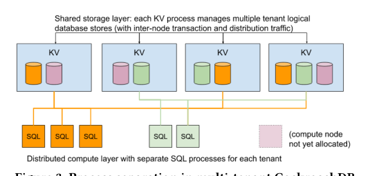
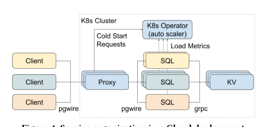

# cockroachdb-sigmod2025-serverless_subsecond_scaling_from_zero

- Note for readers: text below is extracted per PDF page, delimited by
  `<!-- pdf page N -->` markers. Figure images embedded in the PDF are
  extracted under `cockroachdb-sigmod2025-serverless_subsecond_scaling_from_zero.figures/` and linked at the top of the
  page they appear on, ordered top to bottom. Open an image file to see
  the figure; captions stay in the page text. Code listings and fine
  print may render imperfectly as text; fall back to the local PDF.

---

<!-- pdf page 1 -->

# **CockroachDB Serverless: Sub-second Scaling from Zero with Multi-region Cluster Virtualization**

Jeff Swenson, Andy Kimball, Raphael ‘kena’ Poss, Rebecca Taft (Cockroach Labs, New York, USA)

Jay Lim, Adam Storm, Sumeer Bhola, Paul Bulkley-Logston (Cockroach Labs, New York, USA)

PJ Tatlow, Rachael Harding, Rafi Shamim (Cockroach Labs, New York, USA)

Aditya Maru (Blacksmith Software Inc., San Francisco, USA)

Irfan Sharif (Modal Labs, New York, USA)

### **Abstract**

The Serverless database paradigm offers the promise of letting users pay for only what they consume, and scaling quickly and transparently as workload demands change. In this paper, we present novel extensions to CockroachDB that allow for the deployment of a multi-tenant, multi-region transactional database, which can be consumed by users in a Serverless fashion. The key architectural change enabling this new deployment model is a two-tiered approach that separates the SQL and key-value (KV) layers into different processes. This separation enables independent scaling, efficient resource sharing, and tenant isolation. We describe how we have deployed this system in a production service offering, generally available since 2022, and how we achieve scaling-to-zero, sub-second cold starts, and data and performance isolation.

### **CCS Concepts**

- **Information systems** → **DBMS engine architectures** ; **Relational parallel and distributed DBMSs** .

### **Keywords**

serverless database, database as a service, multi-region database, cluster virtualization, cold start

#### **ACM Reference Format:**

Jeff Swenson, Andy Kimball, Raphael ‘kena’ Poss, Rebecca Taft, Jay Lim, Adam Storm, Sumeer Bhola, Paul Bulkley-Logston, PJ Tatlow, Rachael Harding, Rafi Shamim, Aditya Maru, and Irfan Sharif. 2025. CockroachDB Serverless: Sub-second Scaling from Zero with Multi-region Cluster Virtualization. In _Companion of the 2025 International Conference on Management of Data (SIGMOD-Companion ’25), June 22–27, 2025, Berlin, Germany._ ACM, New York, NY, USA, 14 pages. https://doi.org/10.1145/3722212.3724432

This work is licensed under a Creative Commons Attribution-ShareAlike 4.0 International License. _SIGMOD-Companion ’25, Berlin, Germany_ © 2025 Copyright held by the owner/author(s). ACM ISBN 979-8-4007-1564-8/2025/06 https://doi.org/10.1145/3722212.3724432

<!-- Start of picture text -->

Four boxes of different widths: Virtual CockroachDB Cluster #1, #2, #3, #4, each drawn as three replicas. Below them: Physical CockroachDB cluster with six nodes, Node 1 to Node 6. <!-- End of picture text -->

**Figure 1: Four differently sized virtualized clusters leveraging the resources of one CockroachDB physical cluster.**

### **1 Introduction**

_Serverless_ Database as a Service (DBaaS) solutions have become ubiquitous in the last several years and seek to overcome two key limitations of previous DBaaS offerings: the necessity to provision resources for peak workloads and the inability to scale down to zero during idle periods to reduce costs. Highly variable workloads often incur higher costs due to consistent over-provisioning. This cost impact is even more pronounced with distributed database architectures, as _clusters_ of machines are used to achieve high availability and disaster recovery. Many existing Serverless offerings, however, face challenges in fully replacing dedicated DBaaS solutions due to scalability limitations, multi-second cold start latencies, a lack of multi-region support, or some combination of these factors.

The Serverless model presents unique challenges for DBaaS providers. Hardware, storage and even software binaries are shared across customers to amortize investments and enable fast scaling, which presents data security, performance, and scalability challenges. In an ideal Serverless offering, users must be prevented from accessing the data of others, the performance of a given database cannot be impacted by that of co-located databases, and all users must be given the perception of unlimited scalability, with no noticeable cold start penalties. Delivering all of these attributes in such a way that data can be geographically domiciled and is resilient to data center and region failures is even more challenging.

In this paper, we present CockroachDB Serverless, a new DBaaS that leverages a novel architectural evolution of CockroachDB (abbrev. CRDB) [56, 58] called _cluster virtualization_ . A CRDB Serverless

648

<!-- pdf page 2 -->

Jeff Swenson et al.

SIGMOD-Companion ’25, June 22–27, 2025, Berlin, Germany

cluster presents as an independent transactional database, but is actually a virtualized share of a larger physical cluster (see Fig. 1). The architecture leverages a two-tier approach which separates SQL processing from transactional key-value (KV) storage, and forces all SQL operations to pass through a permission-based API when accessing a user’s data. Each user’s SQL operations run in separate processes, co-located on VMs with SQL processes of other users and shared KV processes. This allows for similar security and performance isolation as single-tenant clusters, while achieving more efficient resource utilization and finer-grained billing options.

The system’s separation along the SQL/KV boundary allows for minimally stateful SQL processes that can be instantiated with subsecond latency, therefore allowing for a scale-from-zero experience that may be undetectable by end-users. Other systems [59] split the system along the compute/storage boundary, and therefore require a greater amount of the system to be instantiated at cold-start time, extending cold-start latencies.

CRDB Serverless provides the following benefits:

- **Data and performance isolation** - ensures secure, logical separation of user data and minimizes noisy neighbor impact.

- **Granular shared-resource billing** - employs a novel approach to ensure that users operating on shared hardware are billed accurately for the resources they actually consume (on a query-byquery basis), while providing the means to set quotas to ensure predictable spending limits.

- **Supports scale-to-zero and sub-second cold starts** - automatically scales users to zero compute during prolonged periods of inactivity, while allowing for sub-second first query execution when activity resumes (p99 latency of 650 milliseconds).

- **Responsive autoscaling** - reacts quickly to changes in utilization by adding or removing capacity as needed.

- **Dynamic session migration** - allows for user connections to be seamlessly moved between SQL nodes to allow for transparent scaling and facilitate zero-downtime maintenance operations.

- **Supports robust multi-region deployments** - extends a novel multi-region architecture [58] which supports transactionally consistent cross-region queries, as well as active-active high availability that is tolerant to region failure.

While some of these benefits can be found in existing systems, the described system is the first to combine all of them. More specifically, it is the first system to allow for the fine grained sharing of both compute and storage between users, while at the same time achieving full scale-to-zero and sub-second cold starts, all while supporting active-active multi-region capabilities.

The rest of the paper is organized as follows: Section 2 provides background and related work; Section 3 details our architectural changes; Section 4 covers deployment; Section 5 discusses performance isolation; Section 6 provides an experimental evaluation; Sections 7 to 9 offer lessons learned, future work, and conclusions.

# **2 Background and Related Work**

This section provides background on the challenges faced by a multi-tenant DBaaS (Section 2.1) and the feature expectations that define Serverless computing (Section 2.2).

# **2.1 Multi-tenant DBaaS**

The original motivation for CRDB Serverless was to reduce the cost of small CRDB clusters. Previously, the smallest supported CRDB Cloud cluster was three nodes with 4 vCPU [16]. Multitenancy allows reducing the resource costs of a small cluster to near zero. Implementing such a multi-tenant system requires care; while the system may consist of a large machine or cluster of machines containing many tenants, it must present to each of those tenants as a dedicated and isolated system [34].

_2.1.1 Multi-tenancy variants._ Multi-tenant architectures vary [27, 42]. The simplest method, requiring no change to a single-tenant database’s architecture, is sharing hardware through the use of virtual machines (VMs). This approach is the least efficient, as there is a minimum VM size, and each database process has non-trivial overhead. Shared process multi-tenant databases can amortize the overhead of the database process between multiple database applications [10, 18, 20]. Some databases allow deeper sharing, even co-locating tenant data within a single table [7, 60]. Separating compute and storage (see Section 2.1.2) enables finer-grained control over which resources are shared, e.g., allowing separate-process, shared-hardware multi-tenancy for SQL processing and shared process multi-tenancy at the storage layer. This is the approach taken by CRDB Serverless.

_2.1.2 Separation of storage and compute._ An early barrier to effective multi-tenancy was the coupled nature of storage and compute [26]. Historically, the same compute power used to service SQL query plan generation and execution was also used to manage the storage layer of the database [59]. Such coupling required larger machines to service larger query loads and query spikes regardless of the data set size [1]. A number of systems [5, 11, 19, 35–38, 59, 61] addressed this by hosting data on nodes separate from those responsible for the core compute of the service. CRDB Serverless is different from other systems that have a shared layer for log record and page storage [19, 59], and instead has a shared key-value (KV) layer that supports transactions, localized data placement, and replication (see Section 3.1). CRDB Serverless inherits horizontal write scalability and multi-region capability from the KV layer.

_2.1.3 Data Isolation._ At a logical level, a multi-tenant database should offer data isolation to all of its tenants. Data isolation is needed not only for functional purposes (queries will return incorrect data if isolation is not perfectly achieved), but also for security purposes (a multi-tenant database is not trustworthy if one tenant is able to see the data of another tenant). A multitenant database must allow for tenant isolation, while providing a high-performance mechanism to expose the full feature set of SQL databases. CRDB Serverless achieves this by _cluster virtualization_ (see Section 3.2). Other systems provide data isolation through separate processes [59] or logical separation at the schema level [10], in combination with other mechanisms such as encryption and network security. Research into using secure enclaves [51], confidential VMs [52], or encryption [49] to provide additional security guarantees is promising, but orthogonal to our approach.

_2.1.4 Rate-limiting and performance isolation._ A multi-tenant system must arbitrate access to constrained shared resources in order

649

<!-- pdf page 3 -->

CockroachDB Serverless: Sub-second Scaling from Zero with Multi-region Cluster Virtualization

SIGMOD-Companion ’25, June 22–27, 2025, Berlin, Germany

to deliver predictable query throughput and latency for each user’s workload, regardless of the other workloads running on the shared cluster. Prior research has attempted to avoid the “noisy neighbor” problem through smart tenant placement [18, 31, 55], but it is not always possible to accurately predict tenant workloads. Das et al. and Narasayya et al. demonstrated that fine-grained sharing of resources such as CPU and memory can improve fairness and reduce tenant SLA violations in an overbooked system [21, 43]. CRDB Serverless uses a combination of _process separation_ (Section 4.1), fine-grained performance isolation for the shared key-value (KV) layer (Section 5.1), and per-tenant limits on CPU usage (Section 5.2).

# **2.2 Features for Serverless Computing**

Over the past decade, motivated by the promise of pay for usage pricing and ease of use, industry has found increasing utility for the Serverless paradigm for computing [25, 29]. Early applications of the paradigm were focused on serving short-lived requests that maintained little or no state between invocations. Only recently has the industry attempted to serve stateful workloads like that of a database via the Serverless model [8, 53, 54].

Many academic and commercial database systems now exist with the “Serverless” label [2, 6, 9, 11, 40, 46], but there is wide variability in the supported features. This section outlines key Serverless database features and their implementation challenges.

_2.2.1 Dynamic horizontal scaling._ As one tenant’s query load increases, the compute resources allocated to that tenant must grow proportionally. One tenant’s workload may need dozens or even hundreds of vCPUs to execute, while another tenant’s workload may just need a fraction of a vCPU, and only intermittently. A Serverless database must be able to scale rapidly both in compute and storage to give the impression of infinite capacity.

Serverless compute platforms like AWS lambda support scaling out to thousands of concurrent requests, but allowing application compute to scale horizontally is not helpful if an application’s database is a bottleneck. Some databases claim infinite scaling but fail to scale beyond a maximum VM size [39, 45]. Spanner [17] offers auto scaling “data boost” workers, but they are optimized for nonlatency sensitive workloads [13]. CRDB Serverless scales both keyvalue (KV) and SQL elements horizontally across multiple virtual machines and therefore is not limited by virtual machine sizes (Section 4.2.3). Fast cold start performance enables it to dynamically add SQL servers quickly as a cluster’s load increases (Section 4.3.1).

_2.2.2 Scaling to zero and achieving sub-second cold start latency._ Charging nothing for idle clusters requires shutting down all infrastructure specific to an individual cluster. This process, often referred to as “scaling to zero”, is supported by a number of Serverless offerings [2, 4, 40, 46, 48, 57].

Partnered with scale-to-zero is the need for low-latency query execution once a tenant has scaled-to-zero. This can be referred to as cold-start latency, and is particularly important for OLTP workloads, where queries often execute with sub-second latency.

Spanner avoids the cold start hurdle by requiring a non-zero minimum capacity and never enters a true scale to zero state [12]. Several other databases in the space can scale to zero but have startup times greater than one second, and often much larger [2,

4, 41, 44]. Some databases side step this by requiring a user to manually resume a database before connecting to it [48].

CRDB Serverless scales per-tenant SQL nodes to zero (Section 4), and mitigates cold start latency by maintaining a warm pool of nodes (Section 4.3.1). Shared KV nodes remain active, but do not consume resources (other than storage) for idle tenants.

_2.2.3 Continuous Availability._ The Serverless paradigm promises continuous availability regardless of what’s occurring on the underlying hardware. This is difficult to achieve in Serverless databases where long-lived stateful connections to individual tenants are competing with the cluster’s need to balance resources equitably, handle periodic hardware failures, and support scheduled maintenance. A Serverless database must allow for tenants to be moved between different machines transparently to achieve performance isolation [9]. Such “live migration” is an active area of research [22, 23, 30]. Furthermore, tenants must not be able to observe the impact of scheduled maintenance operations or unscheduled hardware failures. Our approach to this problem is discussed in Section 4.2.4.

_2.2.4 Multi-region._ Pay for usage pricing reduces the cost of multiregion deployments by eliminating charges for unused capacity. Running application logic in multiple regions is straightforward, but requires data to be distributed to each region. Many Serverless DBaaS systems claim multi-region support, but definitions vary widely. Some consider the capability to fail-over to a read-replica in a separate region a multi-region solution [3, 47]. Others allow for multi-region replication but at the cost of an “always on” payment level [17, 40]. CRDB’s built-in support for consistent geo-distributed transactions [56, 58], a region-aware system database (Section 3.2.5), and support for per-tenant region selection (Section 4.2.5) enable full-featured active-active multi-region Serverless.

_2.2.5 Cost attribution and consumption-based billing._ In successful cloud solutions, infrastructure costs should be passed on to the entity that incurs them [19, 28]. Since the resources in a serverless system are non-trivially shared, with elastic allocation depending on load, an accounting question arises: how to tally the effective usage of hardware over time so that the total cost of the hardware is fairly divided across all tenants.

There is additional complexity in the question of cost attribution: hardware resources (e.g. CPU, disk, RAM) are not homogeneous, and have different costs, including across different cloud infrastructure providers. We describe our solution in Section 5.2.

# **3 Multi-tenant system Architecture**

In this section, we first review the aspects of the single-tenant CRDB architecture that remain unchanged in multi-tenant CRDB (Section 3.1). Then we describe cluster virtualization, which represents the key architectural and subsystem changes enabling efficient multi-tenancy (Section 3.2).

# **3.1 Review of CockroachDB’s base architecture**

CRDB was described in our prior work [56, 58]; this sub-section constitutes a summary of its architecture.

CRDB contains two main layers. The key-value (KV) layer implements a KV store and maintains a distributed, replicated and

650

<!-- pdf page 4 -->

Jeff Swenson et al.

SIGMOD-Companion ’25, June 22–27, 2025, Berlin, Germany

transactional logical keyspace on top of distributed physical KV/storage nodes. The SQL layer implements SQL processing and HTTP APIs for inspection and monitoring. The SQL schema metadata and individual table accesses are translated by the SQL layer into basic KV operations sent to the KV layer using RPCs. Our work to introduce multi-tenancy takes advantage of this separation of concerns.

In the KV layer, all data is organized as key-value pairs composed of arbitrary bytes. The transaction, replication, and distribution logic mostly does not care about the internal structure of KV pairs. Pairs are aggregated into _ranges_ , CRDB’s notion of shards. All replication and distribution decisions are made at the level of ranges. Range boundaries are decided solely based on size limits and load due to API requests from the SQL layer. When a KV node receives a request from the SQL layer for a range that it does not know about locally, it redirects the request to the right node using a range directory whose root is known to all KV nodes via a gossip protocol.

The SQL layer provides a richer set of data abstractions, including tables, views, sequences, security principals (usernames, roles), access privileges, configuration settings, and logical versioning, translating them into key-value pairs for persistence and distribution. SQL primarily views storage as a logical, contiguous keyspace of key-value pairs but can directly manage data distribution when necessary. Large SQL queries are compiled into distributed dataflow (“DistSQL”) execution plans, which strategically position computations near relevant data to minimize network latency.

# **3.2 Cluster virtualization**

To support multi-tenancy, we have implemented _cluster virtualization_ on top of CRDB with the following features:

- **Logical storage partitioning.** The KV layer is shared, but each tenant (also called “virtual cluster”) runs a separate instance of the SQL layer with its own portion of the logical keyspace. This segmentation is invisible to client applications. This mechanism is akin to memory virtualization in computer systems.

- **Security boundary between layers.** Each tenant instance is restricted by the KV/SQL boundary to only perform operations on its “own” portion of the keyspace. This mechanism is akin to memory protection in computer systems.

They are detailed further below.

_3.2.1 Storage partitioning._ Each tenant is assigned a segment of the overall KV logical keyspace by means of a _key prefix_ that uniquely identifies the tenant. The prefix is introduced automatically during query execution and stripped when reporting results to SQL clients.

An example is given in Fig. 2: two tenants share a single linear keyspace. Separation is enforced via the prefix. The KV layer enforces that no two tenants can share a single storage range. Range distribution and replication is agnostic of tenant boundaries.

_3.2.2 SQL isolation._ On top of the virtual keyspace, the SQL layer is instantiated anew for each tenant. Each tenant thus maintains its own separate copy of all the SQL metadata, without visibility of that of other tenants.

All the run-time in-memory control data structures that organize SQL sessions, planning and execution are also instantiated anew, side-by-side for each tenant, but without references to each other. The HTTP service that accompanies SQL in the SQL layer is likewise

<!-- Start of picture text -->

Rows: Logical schema (visible from client application); Storage organization (key-value store), where the linear keyspace is physically split across ranges; Physical layer: ranges replicated across storage nodes. Single-tenant architecture: Logical cluster with Table A and Table B. Ranges: [/A/row1, /A/row2, …, /A/row10] [… /A/rowN … /B/row1] [… /B/rowN] Multi-tenant architecture: Virtual cluster X (Table A, Table B) and Virtual cluster Y (Table A, Table B). Ranges: [/X/A/row1 … /X/A/rowN] [… /X/B/rowN] [/Y/A/row1 …] [/Y/A/rowN … /Y/B/rows] Physical layer: three storage nodes, each holds replicas of several ranges. <!-- End of picture text -->

**Figure 2: Keyspace virtualization**

duplicated. Each such instance “knows” of the key prefix its tenant was assigned and is responsible for prefixing KV requests with it but remains blind to the presence of other tenants.

Together, the combination of the virtual keyspace, and the isolation of the SQL layer, virtualizes the experience of a full CRDB cluster from the perspective of client applications.

_3.2.3 Security boundary._ All operations performed by the SQL layer are mediated through the KV/SQL boundary. At that boundary, an authorization component checks incoming requests. The tenant SQL layer authenticates itself by means of a unique TLS certificate. The KV authorization checks that all requests performed by that identity target the specific portion of the keyspace allocated to it.

_3.2.4 System control interface._ Low-level access to the KV layer, for configuration and troubleshooting purposes, is available through a special instance of the SQL service not subject to authorization checks at the SQL/KV boundary. We call this the _system tenant_ . For example, the life cycle of virtual clusters (creation, deletion, backup/restore, etc.) are managed using the system tenant.

We maintain an active instance of this service on every KV node. Due to its heightened privileges, in a multi-tenant deployment, access to the system tenant is highly restricted and is available only to system operators, via separate credentials. For defense-in-depth, this restricted access is further enforced at the network level via separate TCP access routes and network-level transport security.

_3.2.5 Multi-region performance optimizations._ In virtualized clusters spanning multiple regions, care is needed to avoid performance degradation due to increased latency of SQL-KV communication.

One place where multi-region deployments especially impact virtualized clusters is during cold starts of SQL nodes, due to the need to perform multiple blocking reads and writes to the system database. For example, the node must read system.descriptor to fetch the application’s SQL schema and must write a row to system.sql_instances to make the node discoverable to other SQL nodes for DistSQL routing. Using the default configuration for the system database would place all leaseholders (primary replicas) in one region, which would require cross-region accesses for all nodes outside that region and increase cold start latency.

651

<!-- pdf page 5 -->

**Figures on page 5:**

CockroachDB Serverless: Sub-second Scaling from Zero with Multi-region Cluster Virtualization

SIGMOD-Companion ’25, June 22–27, 2025, Berlin, Germany

We solve the multi-region cold start problem by using the novel multi-region abstractions offered by CRDB [58], for optimizing access latency. In particular, we use the concept of “table locality” which optimizes a table for a particular access pattern. These table localities are used to configure the system database so that a SQL node can start up without blocking on cross-region network traffic. Specifically, _global_ tables allow for consistent local reads at the cost of higher write latency. Tables like system.descriptor, that need consistent reads with low latency, are converted to global tables. The _regional by row_ locality allows partitioning a table so that the leaseholder for each row is located in a specific region. Tables like system.sql_instances, that have latency sensitive writes, are converted to regional by row tables.

_Follower reads_ allow for stale reads from a follower replica. Follower reads are used to read from the _META_ range that is used to locate which KV node is serving a KV range. Follower reads are a good fit for reading from the _META_ range because the KV nodes will redirect requests if a range moves.

# **4 Serverless Architecture**

The term “serverless architecture” designates the way we deploy multi-tenant CRDB as a fleet of distributed processes that can grow and shrink based on application load. Section 4.1 describes the process boundaries used in CRDB Serverless, and Section 4.2 describes the orchestration of those processes and design decisions made to effectively deploy and run CRDB Serverless as a production service. Section 4.3 describes some performance optimizations that reduced cold-start times and improved auto-scaling reaction time.

<!-- Start of picture text -->

Shared storage layer: each KV process manages multiple tenant logical database stores (with inter-node transaction and distribution traffic). Four KV processes, each holds stores of several tenants. Distributed compute layer with separate SQL processes for each tenant: tenant 1 has three SQL processes, tenant 2 has two SQL processes, tenant 3 has none (compute node not yet allocated). <!-- End of picture text -->

**Figure 3: Process separation in multi-tenant CockroachDB**

<!-- Start of picture text -->

K8s Cluster contains Proxy, SQL nodes, KV nodes and the K8s Operator (auto scaler). Client → (pgwire) → Proxy → (pgwire) → SQL → (grpc) → KV Proxy → K8s Operator: Cold Start Requests SQL → K8s Operator: Load Metrics <!-- End of picture text -->

**Figure 4: Service organization in a Cloud deployment**

# **4.1 Hybrid isolation into processes**

In a multi-tenant deployment, we isolate the SQL (compute) layer by running each instance of the SQL layer as a separate OS process. We call each such process a “SQL node”. The KV (storage) layer runs operations on behalf of multiple tenants within single processes. A diagram of the architecture is given in Fig. 3, showing three tenants hosted across a shared, four-node KV layer. One tenant is “suspended” and does not have SQL nodes allocated to it.

We chose this hybrid isolation model as an educated trade-off. One alternative was to use a single OS process to run the compute load from multiple tenants. Here, the lack of comprehensive OS controls to isolate performance of separate threads within one process meant we risked one tenant’s runaway SQL query disrupting the performance of other tenants. Additionally, enforcing a confidentiality barrier within a single process with our relatively complex SQL code base requires software engineering discipline to avoid global state, creating unnecessary risk. A process boundary was a natural and effective solution to these challenges.

Sharing the KV layer across tenants then raises the same confidentiality and performance isolation questions that motivated separate processes for compute. Here, we observed that the KV layer already implements data isolation internally: each KV range is processed independently, and no data is ever leaked from one range to another. This was already true in CRDB prior to the introduction of multi-tenancy: it ensures that a system fault affecting one range cannot affect the rest of the system. Only performance isolation remains to be solved, which we discuss in Section 5.

# **4.2 Serverless orchestration**

In the following subsections, we contrast “Serverless” deployments, based on the contribution from this paper, with the previous “Dedicated” deployment style, where each tenant would be served with a separate set of DB nodes per tenant, with dedicated hardware.

_4.2.1 Kubernetes deployment._ Each multi-tenant Serverless region is implemented as a single Kubernetes (K8s) cluster [33] including shared KV nodes, per-tenant SQL nodes, a routing proxy service, and ancillary monitoring (multi-region is slightly different; see Section 4.2.5). A simplified view is given in Fig. 4.

To amortize costs, we run multiple SQL nodes on each virtual machine. This benefits “long-tail” tenants with small or idle workloads. Consolidating many small SQL servers on a single VM reduces hardware requirements by 2–10x, since idle nodes consume only a fraction of a CPU, while cloud providers typically require a minimum of 1 vCPU per VM.

Sharing virtual machines between tenants presents challenges to security and performance isolation. K8s uses separate Linux [32] and network namespaces [24] to ensure security isolation between pods. We use cgroups to limit maximum CPU usage per node, but nodes are oversubscribed. As a result, we rely primarily on capacity planning and the per-tenant eCPU limits to maintain performance isolation (see Section 5).

The use of K8s for management helps reduce SQL scale-up latency by internalizing management events within our control plane. Without K8s, e.g. in Dedicated deployments, we use the cloud provider’s APIs to add new VMs, allocate IP addresses, etc. Creating a new Serverless SQL node takes 3 seconds, versus 30 minutes for a Dedicated CRDB cluster. We also maintain a pre-allocated pool of SQL nodes to cut latency further.

652

<!-- pdf page 6 -->

Jeff Swenson et al.

SIGMOD-Companion ’25, June 22–27, 2025, Berlin, Germany

_4.2.2 Tenant routing and load balancing._ A core component of Serverless deployments is routing and dynamic load balancing. We call this the “proxy” service. There are multiple instances of the proxy service per deployment.

The proxy service’s routing function removes the need for separate public IP addresses for each tenant. Upon receiving a new connection, a proxy server analyzes the incoming PostgreSQL startup message [50] to identify the tenant. If a tenant has multiple SQL nodes, the proxy selects a SQL node from the pool using a “least connections” algorithm, which relies on two assumptions: (1) connections are distributed evenly among the proxy servers by upstream Cloud TCP load balancers, and (2) client connection pools distribute load evenly across open SQL connections.

Proxy servers periodically re-balance connections across available SQL nodes. During a scale-down event, connections are migrated from the terminating nodes to the healthy ones. During a scale-up event, some connections are migrated from the existing nodes to new nodes to smooth out distribution. The underlying mechanism is explained in Section 4.2.4.

The proxy service is responsible for two security controls. It detects negative SQL client authentication responses from the backend and throttles further connection attempts from the same origin with exponential back-off until authentication succeeds. It also enforces IP allowlists and denylists. These lists are co-specified by the tenant and internal intrusion detection systems.

_4.2.3 Automatic scaling of SQL/compute._ CRDB’s KV layer already supports transparent horizontal scaling of storage. Serverless inherits the data scalability of the underlying CRDB architecture. As an individual tenant grows in size, its data is automatically re-sharded and re-distributed across the host cluster. We do not detail this aspect further here and instead refer the reader to Section 3.1 and our previous publication [56]. Our contribution in this paper focuses on auto-scaling SQL nodes.

Our goal is to automatically allocate SQL nodes in response to tenant query load, handling spikes with low latency. This design reflects two observations: (1) compute drives cost, and (2) tenant load spikes are usually uncorrelated. Fast scale-up and scale-down allow us to respond effectively to client usage spikes while underprovisioning less active clients and shutting down compute for idle workloads altogether.

All SQL nodes are allocated the same hardware limit (4 vCPUs and 12GB RAM). In practice, actual usage is much lower, so we oversubscribe resources. For example, when analyzing production data from a typical day, we observe that the p99 memory usage is around 2.5GB, well below the allocated limits. When a tenant requires more CPU or memory, we choose to allocate SQL nodes rather than increasing vCPU/RAM for existing nodes. Choosing horizontal over vertical scaling removes many scalability limits in the number of clients, tenants and queries.

The agent responsible for scaling is called the “autoscaler”, runs on every K8s cluster, and manages scaling by interacting directly with K8s’s control API. The autoscaler determines the ideal number of SQL nodes to assign to each tenant based on the combined CPU usage of the tenant’s SQL nodes. Two metrics are used: the average CPU usage over the last 5 minutes and the peak CPU usage during the last 5 minutes. The autoscaler ensures the total capacity

available to SQL nodes is 4x the average CPU usage or 1.33x the max CPU usage, whichever is larger. This algorithm combines a moving average for stability with an instantaneous maximum for responsiveness, allowing the autoscaler to quickly detect and react to large spikes in load while avoiding too-frequent scaling.

For example, for a tenant with average usage of 2.5 vCPUs, the autoscaler targets 10 vCPUs (2 _._ 5 ∗ 4), allocating three 4-vCPU SQL nodes (⌈10/4⌉ = 3). If the max vCPU usage momentarily spikes up to 11 vCPUs, the autoscaler would compute a target capacity of 14.6 (11 ∗ 1 _._ 33) which requires allocating a fourth SQL node for the tenant, providing a total capacity of 16 vCPUs. Because of oversubscription, this approach provides substantial headroom for sudden bursts while keeping overall costs low.

In order to minimize SQL node start-up latency, we maintain a pool of pre-warmed nodes. If a client tries to connect to a tenant with no SQL nodes assigned to it, the proxy will initiate the same K8s reconciliation process used by the autoscaler for scaling: a SQL node is pulled from the pre-warmed pool of SQL nodes, stamped with the tenant identifier, and made available for connections.

When tenant query load drops, the autoscaler puts excess SQL nodes into a draining state. This lets applications close some connections while the proxy transparently migrates others (see Section 4.2.4). A node shuts down once all connections close or after 10 minutes. To reduce churn, draining nodes are reused before pre-warmed ones, and minor load changes are ignored.

If the application load falls to zero, the autoscaler eventually suspends the tenant, and all its SQL nodes are removed. At this point, it does not consume any CPU, I/O, or bandwidth. The only cost is for storage of the tenant’s data, which is relatively cheap.

_4.2.4 Dynamic session migration._ One key mechanism to reduce disruptions during SQL scale-down is migrating connections away from SQL nodes that are draining. This is critical because most production tenants maintain long-lived connections with many connections lasting hours or even days. Connection migration is handled by the proxy service when the client session is idle (no open transaction). In this state, the proxy buffers incoming pgwire messages and requests the SQL node to serialize the session, capturing client settings and prepared statements.

The serialized session includes a “revival token,” an internal authentication credential that lets the proxy resume the session on a new SQL node without client re-authentication. The new node restores the session using this data, making the migration seamless from the client’s perspective. We have published a detailed technical description of this protocol [15].

_4.2.5 Multi-Region Serverless._ For multi-region support we configure a global CRDB cluster consisting of many regions. Each region contains a distinct K8s cluster, and the K8s cluster’s networks are peered together so that the CRDB cluster processes can communicate. When a tenant creates a Serverless cluster, they can pick a subset of the regions that are available in the global cluster. The system database in the Serverless cluster is configured to match the regions selected by the tenant, and CRDB provides the illusion that the regions configured in the system database are the only regions available in the cluster.

Tenants are provided with a global DNS name and per-region DNS names. The per-region DNS names always route to a specific

653

<!-- pdf page 7 -->

CockroachDB Serverless: Sub-second Scaling from Zero with Multi-region Cluster Virtualization

SIGMOD-Companion ’25, June 22–27, 2025, Berlin, Germany

region. The global DNS name uses geo-routing to automatically route the connection to the nearest region in the cluster.

# **4.3 Performance optimizations**

This section describes two performance optimizations we made to reduce cold start times (Section 4.3.1) and to improve the responsiveness of autoscaling (Section 4.3.2).

_4.3.1 Cold start latency reduction._ In our original implementation, K8s pods containing SQL nodes were pre-warmed, but did not have a running SQL process until a tenant was assigned. Allocating a SQL node for the tenant required sending mTLS certificates to the pod and starting up the SQL node’s process. The cold start flow was revamped so that the SQL process was started before the tenant ID was known. The pre-warmed SQL node process uses a file system watch to detect when the tenant’s mTLS certificates are available. Once certificates are written to the SQL node’s file system, the SQL node connects to the KV layer and finishes initialization.

_4.3.2 Responsive autoscaling._ Responsive autoscaling requires fresh, accurate CPU metrics from SQL nodes. Our initial implementation used Prometheus to scrape and store these metrics. However, this created a pipeline with too much latency, including a 10 second metrics generation interval, a 10 second metrics scrape interval, and a 10 second Prometheus query interval. These overlapping polling intervals resulted in scaling reaction times of 20-30 seconds. Our solution: update the autoscaler to directly scrape just-in-time CPU metrics from the SQL nodes at a 3 second interval - a 6-10x speedup in reaction time.

# **5 Performance isolation and cost attribution**

To ensure performance isolation of tenants, we implemented two systems to control resource usage. Admission control (Section 5.1) is a per-node system that ensures system stability and fair scheduling when KV nodes are overloaded. A per-tenant distributed token bucket measures tenant CPU usage and enforces CPU quota limits (Section 5.2) at the cluster level.

# **5.1 Admission Control**

What happens if KV calls from multiple tenants threaten to overload a KV node? In that case, CRDB _admission control_ (AC) kicks in. The AC system integrates with the Golang CPU/goroutine scheduler (CRDB is implemented in Go) and the storage engine, and maintains queues of work that ensure fairness across tenants. Each tenant’s GET, PUT, and DELETE requests are given a roughly equal allocation of CPU time and storage I/O. This ensures that a single tenant cannot monopolize resources on a KV node.

_5.1.1 Bottleneck Resources._ As a reminder, the stateful KV layer handles reads and writes, replication of writes, and concurrency control (latching and locking). Reads may target a single key or a key span. KV operations are often bottlenecked on CPU or write bandwidth, so performance isolation across tenants is a requirement. Isolation is achieved via several mechanisms: (a) nodes that are bottlenecked along a resource dimension shed load by rebalancing ranges to other nodes, (b) a bottleneck node fairly allocates resources to the multiple tenants consuming resources at the node. Rebalancing (mechanism (a)) operates at longer time scales, since

there is cost to rebalancing, while mechanism (b) reacts immediately. The rebalancing mechanism is not unique to CRDB Serverless and is discussed in [56], so in this section we focus on (b).

When fairly allocating a bottleneck resource, we also desire to minimize unused resource. We focus on two resources that typically become the bottleneck: CPU and write bandwidth. Each node has a CPU AC queue ( _CQ_ ), and a write AC queue ( _WQ_ ). Read operations only queue in the CQ and write operations sequentially queue in the WQ and then the CQ. Admitted operations proceed to do their real work. Operations can wait arbitrarily long in these queues (by design), when resources are lacking, and the system respects operation deadlines by removing them from the queue.

_5.1.2 Fair allocation._ The AC queues are implemented as a hierarchy of heaps, with the top-level being a heap of tenants with waiting operations, and for each tenant a heap of waiting operations organized by priority and transaction start time. The top-level heap is ordered such that the _least-consuming_ tenant is at the top, so it will receive the next allocation – this provides fairness of allocation across tenants. The notion of _least-consuming_ varies by resource. For CPU, it is _cpu-time_ consumed by this tenant over a recent interval. For write bandwidth, it is bytes written by that tenant over a recent interval. To ensure an operation that is admitted does not consume an unbounded amount of a resource (e.g. cpuseconds), operation implementations are written to cooperatively release resources after a bounded amount of resource consumption, and subsequently need to get re-admitted.

_5.1.3 Capacity estimation._ To fairly allocate CPU time and write bandwidth without overloading the system, we must estimate the resource capacity of the system and the resource usage by each operation. New operations with estimated usage that exceeds the estimated capacity of the system are queued as stated above. Admitted KV operations are not necessarily CPU bound. They can block on latches and locks and do I/O. We dynamically estimate a count of concurrent admitted operations that will keep the CPU utilization high (90+%, so work-conserving), while minimizing queueing of runnable threads in the CPU scheduler. This dynamic estimation is done by high frequency sampling (1000Hz) of the runnable queue lengths in the CPU scheduler, and using an additive increasedecrease feedback loop. We refer to the current concurrency as the number of CPU admission _slots_ .

CRDB uses a log-structured merge (LSM) tree (Pebble [14]) for storage. The observable write bottleneck can be either in (a) the bandwidth at which new writes can be flushed from the memtables into immutable files in level 0 of the LSM tree, or (b) the bandwidth with which immutable files in level 0 are compacted down to lower levels. Level 0 in LSMs is special in that files can be overlapping in the key space, so a backlog of files in this level increases read amplification and slows down reads. We dynamically estimate the capacity of both bottlenecks, based on deep instrumentation of the LSM implementation, at 15 second intervals. This capacity is expressed in bytes/s and is used as the refill rate of a _token_ bucket where each token is a write byte.

_5.1.4 Usage estimation._ Per operation resource usage estimation is needed to decide how much of the capacity (CPU slots or write tokens), is consumed by an admitted operation.

654

<!-- pdf page 8 -->

Jeff Swenson et al.

SIGMOD-Companion ’25, June 22–27, 2025, Berlin, Germany

For CPU, one slot is occupied by an admitted operation as long as it is running, and then returned, so there is not an obvious need for CPU usage estimation. However, we also use CPU usage due to:

- An operation should not monopolize a slot for a long duration, since it can result in poor latency isolation. Hence, operations are limited in how much CPU they will use before returning with a resumption marker. The resumption marker is used by the caller to issue another operation.

- For inter-tenant fairness, we want to know how much CPU was actually consumed when the operation completes. We have instrumented the language runtime to provide this CPU consumption information.

For write bytes, we use instrumentation of Pebble [14] to dynamically estimate linear models of the form _𝑎_ ∗ _𝑥_ + _𝑏_ to estimate the actual write bytes for an operation that is trying to write _𝑥_ bytes. This is needed to account for the fact that writes are written to the raft log, for consensus, and are later written to the state machine.

# **5.2 Tenant CPU Attribution**

Each tenant in a cluster is assigned a CPU quota. Clusters that are configured to pay for capacity are charged for their quota limit and clusters that pay for usage are only charged for the resources consumed. It’s difficult to directly measure KV CPU usage for an individual tenant, so a model is used to estimate the CPU cost of each KV operation (Section 5.2.1). Quota enforcement is implemented by a distributed token bucket (Section 5.2.2).

_5.2.1 Estimated CPU model._ In addition to ensuring tenant isolation, we need to fairly charge each tenant for the resources they consume. This is straightforward for resources like egress or SQL layer CPU, where we know exactly how many bytes a tenant returns to the application or how much CPU a tenant’s SQL nodes consume. However, it is more challenging for the KV layer, where CPU is shared across tenants. For example, when the system spends significant CPU compacting LSM files, it is not practical to attribute those costs to individual tenants.

To address this challenge, we built a model that estimates pertenant CPU usage based on key-value (KV) API requests. In CRDB, each SQL query is translated into a batched sequence of lower-level KV requests like GET, PUT, and DELETE. The inputs to the model include whether a request is a read or a write, whether it is batched with other requests, and how many bytes it sends or receives in response. The model output is the cost of the request expressed in _estimated CPU_ , for the KV layer. That is combined with actual CPU usage for the SQL layer, which can be directly measured since SQL nodes are tied to a single tenant.

`estimated_cpu = actual_sql_cpu + estimated_kv_cpu`

For a given workload, estimated CPU consumption on a Serverless virtual cluster is expected to roughly correspond to CPU consumption on a physical cluster running on dedicated hardware. To train an estimated CPU model to do this, we decomposed the larger model into smaller, simpler models that predict KV CPU consumption for each of six input features:

- Number of read batches.

- Number of requests in each read batch.

<!-- Start of picture text -->

Line chart. x: Write Batches / second (0 to ~12,800). y: Write Batches / KV CPU (~700 to ~3,350). The curve rises steeply, then flattens: ~700 near 0, ~1,350 at ~800, ~2,200 at ~3,200, ~2,750 at ~6,400, ~3,350 at ~12,800. <!-- End of picture text -->

**Figure 5: Write batches per second determines CPU usage.**

- Number of bytes in each read batch.

- Number of write batches.

- Number of requests in each write batch.

- Number of bytes in each write batch.

Then, the output of the larger model is simply the sum of the predictions of each of the smaller models.

We trained the smaller models by analyzing CPU consumption differences across controlled tests that isolate each metric in turn. For example, the cost of a write batch can be derived by running a test that varies only the number of write batches per second, while keeping all other input features constant. The changes in CPU consumption can then be attributed to the changes in the write batch rate. As with most of the input features, we found that there is a non-linear relationship that determines CPU consumption, shown in Fig. 5. In this case, the more write batches that a given CRDB node processes per second, the more efficient is its CPU usage, due to batching optimizations in the KV layer. We approximate the CPU consumption curve with a piecewise linear function that calculates the number of write batches that each vCPU can process. The other five input features are handled similarly.

_5.2.2 CPU Quota Enforcement._ Serverless CPU consumption can be rate limited to restrict usage on a per-tenant basis. Rate limiting is enforced by a token bucket with state stored in a system database SQL table. The token bucket refills at 1000 tokens/second per vCPU, where each token represents one millisecond of estimated CPU. Each SQL node belonging to the tenant requests tokens from its bucket at a rate that corresponds to its CPU usage over the last 10 seconds. The node also maintains a local buffer of tokens to handle temporary bursts of activity without waiting for a roundtrip to the token bucket server.

As long as there are enough tokens to satisfy all requests, each SQL server is granted its full request. However, when multiple SQL nodes are requesting tokens at a rate that exceeds the limit, it’s challenging for the token bucket server to respond. If it provides too many tokens to one SQL node, it may unfairly starve another SQL node. In addition, if a SQL node does not receive enough tokens, it can exhibit undesirable stop/start behavior, where it runs user queries at full speed until it runs out of tokens, and then abruptly stops all user queries while it waits for more tokens from the server.

To solve these problems, the token bucket server begins making _trickle grants_ when the token bucket is empty. A trickle grant is expressed as a tokens/second rate, and instructs the requesting SQL node that it should run user queries at a smooth, but reduced rate. This prevents stop/start behavior. What remains is for the token granter to ensure that the combined trickle grants match the token bucket refill rate, even when SQL nodes are stopping and starting

655

<!-- pdf page 9 -->

CockroachDB Serverless: Sub-second Scaling from Zero with Multi-region Cluster Virtualization

SIGMOD-Companion ’25, June 22–27, 2025, Berlin, Germany

<!-- Start of picture text -->

(a) CPU Usage, Cores Used, Serverless vs Traditional: TPC-C ~160 vs ~160; TPC-H Q1 ~110 vs ~45; TPC-H Q9 ~138 vs ~140. (b) Latency (ms), split y-axis, p50 / p99: TPC-C New Order: Serverless ~18 / ~33; Traditional ~20 / ~32. TPC-H Q1: Serverless ~17,500 / ~27,500; Traditional ~5,500 / ~11,500. TPC-H Q9: Serverless ~10,000 / ~11,500; Traditional ~7,000 / ~8,500. <!-- End of picture text -->

**Figure 6: CPU usage and latency of TPC-C and two TPC-H queries in 320-core Serverless and Traditional deployments**

and requesting tokens at shifting intervals and rates. The solution is to ensure a statistical guarantee rather than an absolute guarantee. Over time, the average rate of token consumption should not exceed the token bucket refill rate, even if it may temporarily diverge. The server does this by iteratively converging on the moving average of recent trickle grants it has made. Very quickly, each SQL node will be receiving its fair share of the bucket refill rate.

# **6 Evaluation**

This section presents a comprehensive evaluation of CRDB Serverless. First, we show that the efficiency and scalability of CRDB Serverless is comparable to a traditional CRDB deployment for OLTP workloads, but is somewhat reduced for OLAP workloads (Section 6.1). Section 6.2 shows that fixed costs are amortized across large numbers of suspended or idle tenants. We show that the autoscaler effectively responds to changes in utilization by increasing or decreasing SQL node capacity (Section 6.3), and the impact of connection migration is minimal (Section 6.4). Section 6.5 shows that pre-warming and multi-region optimizations can reduce cold start latency by 50% or more. Finally, we show that admission control and CPU consumption limits mitigate the impact of noisy neighbors (Section 6.6), and the estimated CPU model matches the actual CPU utilization of a Dedicated cluster in most cases (Section 6.7).

# **6.1 Efficiency and Scalability**

We evaluate the efficiency and scalability of CRDB Serverless’s architecture of separate SQL and KV servers by comparing it to a traditional CRDB deployment. We run the TPC-C and TPC-H workloads bundled into the CRDB binary against Serverless and traditional clusters, and present CPU utilization (Fig. 6a) and latency (Fig. 6b) results. Each cluster has 10 n2-standard-32 machines for a total of 320 cores per cluster. The traditional cluster has a single KV+SQL CRDB process on each VM. The Serverless cluster has one SQL tenant process and one KV process on each VM. We run the workload driver on a VM in the same cloud zone. The workloads use the default r=3 raft replication, and ranges are scattered randomly across the cluster. This creates a realistic test scenario for CRDB, where most SQL queries require data from multiple KV servers.

_6.1.1 TPC-C (OLTP) Efficiency._ We configure TPC-C to use 10K warehouses and the default mix of transactions. Both clusters successfully pass the workload with 2.1K tpmC. The two modes show

similar CPU usage and query latency, which is unsurprising given CRDB’s architecture. CRDB has the ability to distribute SQL execution across nodes, but for OLTP queries, the SQL engine typically uses the same remote KV APIs used by Serverless.

_6.1.2 TPC-H (OLAP) Performance._ TPC-H is an OLAP workload and highlights a core weakness in the Serverless architecture: the KV API used by SQL servers does not support filtering rows based on column values or aggregation. We focus on two queries from TPC-H using scale factor 10. TPC-H Q1 performs a full table scan with aggregation. In the traditional cluster, DistSQL aggregates on the nodes with the data, avoiding the need to marshal each KV into an RPC. In the case of Serverless, DistSQL can still push the query to the SQL server running on the same VM as the KV server, but the rows need to be marshaled and un-marshaled between the processes. This requires 2.3x more CPU usage to serve the same query volume. TPC-H Q9 is a more complicated OLAP query involving 6 joins before an aggregation. Q9’s plan relies on index joins resulting in remote KV lookups for the joined row, so the Serverless and traditional deployments have similar efficiency.

# **6.2 Per Tenant Overhead**

CRDB Serverless offers a free tier, and even for the paid plan the cost per cluster starts at zero. Therefore, the large majority of Serverless clusters see no or little usage. We consider a tenant to be _suspended_ if there are no active connections to the tenant and the tenant’s SQL nodes were scaled to zero. A tenant is considered _idle_ if there is at least one active connection but there are no active queries. An idle tenant requires a live SQL node to serve the connection. Idle tenants are common because many applications maintain an active connection pool even if they have no work to do. From a business standpoint, charging nothing for a cluster requires the cost of _suspended_ and _idle_ tenants to be very small.

We estimate the overhead of each _suspended_ tenant by creating tenants in a non-production cluster and dividing the total resource usage by the number of tenants. For this test, the cluster only contains suspended tenants, and uses empty tenants to measure the overhead of each tenant. As tenants are added to the cluster, the per-tenant overhead drops as fixed overhead is amortized across an increasing number of tenants. At 20K suspended tenants, the memory overhead for each tenant is 262 KiB (Fig. 7a), and the CPU overhead is close to 0. The fixed storage overhead, i.e., beyond what the tenant explicitly stores, is 195 KiB.

We use a similar method for estimating the KV overhead introduced by each _idle_ tenant. We create idle tenants and measure the amortized resource usage of the KV nodes. At 1200 idle tenants, the memory overhead for each tenant is 3.3 MiB and the CPU overhead per tenant is 0.001 CPU seconds/second (Fig. 7b). The SQL overhead is small, but larger than the KV layer, since such tenants have an idle SQL node with a single SQL connection: it consumes 180 MiB of memory and 0.15 CPU seconds/second.

# **6.3 Responsive Autoscaling**

To demonstrate the effectiveness of the autoscaler (Section 4.2.3), we examined recent production data and found a tenant that experienced variable activity over the course of a few hours. Fig. 8 shows that the autoscaler responds to increases in CPU utilization

656

<!-- pdf page 10 -->

Jeff Swenson et al.

SIGMOD-Companion ’25, June 22–27, 2025, Berlin, Germany

<!-- Start of picture text -->

(a) x: # of Suspended Tenants (5,000 to 20,000). y: Usage (MiB). Memory Per Tenant: ~0.46 at 5,000, ~0.31 at 10,000, ~0.26 at 15,000 and 20,000. Storage Per Tenant: flat at ~0.19. (b) x: # of Idle Tenants (~100 to ~1,250). Memory Per Tenant (MiB): ~3.8 at 100, peak ~4.1 at 200, ~3.5 at 400 to 500, ~3.4 from 600 to 1,100, ~3.3 at 1,250. KV CPU Cores Per Tenant: ~0.0049 at 100, ~0.0025 at 300 to 400, ~0.0019 at 500, ~0.0015 at 1,250. <!-- End of picture text -->

**Figure 7: Memory and CPU usage scales sublinearly with increasing numbers of suspended and idle tenants.**

<!-- Start of picture text -->

x: Time (s), 0 to ~29K. y: Count, 0 to 6. Series: Allocated SQL Nodes (solid), Average CPUs Used (dashed). Allocated SQL Nodes steps between 1 and 6: 1 until ~5K, 5 to 6 from ~10K to ~22K (6 at ~12K to ~14K and ~18.5K to ~20K), back to 1 after ~26K. Average CPUs Used follows below the node count (~0.1 when idle). <!-- End of picture text -->

**Figure 8: SQL nodes are scaled dynamically based on CPU utilization. Each SQL node has 4 vCPUs.**

by adding more SQL nodes, and removes SQL nodes after a period of reduced activity. The close alignment of the utilization and capacity curves suggests that the autoscaling algorithm works as intended: the autoscaler maintains one SQL node per average vCPU used over the last 5 minutes, since each SQL node has 4 vCPUs and the target capacity available to SQL nodes is 4x the average vCPU used.

# **6.4 Impact of Connection Migrations**

Connection migrations are rare: over a 31-day span, the daily average of connection migrations over proxied connections is less than 1%. Still, when migrations do occur, their impact on tenants should be minimal. A recent rolling upgrade - an ideal test because it forces all connections to migrate - demonstrates the typical impact of dynamic session migration (Section 4.2.4). We choose a large production tenant with multiple SQL nodes and many connections to ensure a demanding scenario. Fig. 9 shows that there was no noticeable impact on SQL throughput or latency during the upgrade of the tenant’s three SQL nodes from CockroachDB v24.2.3 to v24.2.4. The transaction abort rate was zero throughout the upgrade.

# **6.5 Cold start latency reduction**

This section evaluates the effectiveness of the optimizations described in Sections 3.2.5 and 4.3.1 to reduce cold-start times.

_6.5.1 Impact of pre-warming a running SQL process._ As described in Section 4.3.1, CRDB Serverless maintains a pool of pre-allocated containers for SQL nodes. The cluster automation pre-starts SQL processes within the container. Pre-warming the process reduces the 50th and 99th percentile cold start latency by more than half (see Fig. 10a). The impact is measured using our production cold-start prober. The prober measures how long it takes to open a connection

<!-- Start of picture text -->

x: Time (s), 0 to ~4.1K. Three panels. Open SQL Connections: three v24.2.3 SQL nodes hold ~75 to ~90 connections each. They drain one at a time at ~2.0K, ~2.3K and ~2.6K s, while three v24.2.4 SQL nodes rise from 0 to ~75 to ~95. SQL Operations: ~1.0K to ~1.9K for the whole run, no drop during the upgrade. Latency (ms): p50 ~2.5, p95 ~3.5 to ~4.5, p99 ~4.5 to ~7 with spikes to ~8 near 1K s and ~10.5 near 2.9K s. <!-- End of picture text -->

**Figure 9: Connection migration due to rolling upgrades does not noticeably impact throughput or latency of tenants.**

<!-- Start of picture text -->

(a) Cold Start Latency (ms), Optimized vs Unoptimized: p50 ~430 vs ~900; p99 ~660 vs ~1,380. (b) Cold Start Latency (s) by Region, p50 / p99: asia-southeast1: Optimized ~0.6 / ~1.5; Unoptimized ~0.6 / ~1.6. europe-west1: Optimized ~0.7 / ~1.9; Unoptimized ~9 / ~11.7. us-central1: Optimized ~0.7 / ~2.7; Unoptimized ~11.7 / ~13.9. <!-- End of picture text -->

**Figure 10: (a) Production cold start latency before (unoptimized) and after (optimized) pre-warming the SQL node process. (b) SQL node cold start latency for multi-region tenants. Optimized tenants were configured with multi-region aware system databases. Unoptimized tenants had lease holders placed in asia-southeast1.**

and read a row from a suspended cluster. Two factors contribute to the latency improvement: (1) Starting a process in a K8s container may take up to a second. (2) Starting the process allows the SQL node to open the SQL TCP listener before the tenant ID is assigned. The proxy starts a TCP connection to the SQL node before it is fully initialized. Opening the TCP listener allows the proxy’s connection attempt to wait in the accept queue instead of generating a TCP reset. The proxy retries TCP resets with exponential backoff, which effectively double the client measured initialization time.

_6.5.2 Impact of multi-region system database optimizations._ We now evaluate the effectiveness of the multi-region system database optimizations described by Section 3.2.5. Two multi-region host clusters are set up to use the production K8s automation with K8s clusters in asia-southeast1, europe-west1, and us-central1. In one host cluster, tenants are configured with the multi-region aware system database. In the other host cluster, tenants are configured with a system database that sets the lease preference to asia-southeast1. Cold starts are measured using a prober that runs in each region. The prober measures the end to end time required to open a connection, start the tenant’s pod, authenticate, and select a row. The results in Fig. 10b show that the region aware system database allows for sub second cold starts in every region (p50 <= 0.73s).

657

<!-- pdf page 11 -->

SIGMOD-Companion ’25, June 22–27, 2025, Berlin, Germany

CockroachDB Serverless: Sub-second Scaling from Zero with Multi-region Cluster Virtualization

|         | No Limits | AC only | AC & eCPU Limits |
| ------- | --------- | ------- | ---------------- |
| p50 (s) | 3.179     | 0.192   | 0.019            |
| p99 (s) | 24.815    | 0.978   | 0.037            |
| tpmC    | 181.669   | 206.865 | 209.483          |

**Table 1: 50th and 99th percentile latency and throughput of well-behaved tenant on cluster with noisy neighbors is improved by admission control (AC) and eCPU limits.**

<!-- Start of picture text -->

Histogram. x: error of estimated Serverless CPU against actual Dedicated CPU, bins of 10% from −80% to 80%. y: Test Count. Counts: −40%: 1, −20%: 1, −10%: 3, 0%: 7, 10%: 5, 20%: 2, 30%: 1, 40%: 1, 50%: 1, 80%: 1 (23 tests). Other bins: 0. <!-- End of picture text -->

**Figure 11: Estimated Serverless CPU v. Actual Dedicated CPU.**

# **6.6 Admission Control and CPU Usage Limits**

We measure the effectiveness of admission control and estimated CPU usage limits using multiple tenants simulating the impact of noisy neighbors. All tenants are running TPC-C. Each VM contains a shared KV node and a SQL node for each tenant. Three “noisy neighbor” tenants run TPC-C with no wait and one worker per warehouse. The noisy tenants execute transactions in a tight loop with no contention and and can individually consume all of the capacity in the cluster. A fourth test tenant runs TPC-C in a stock configuration, which has several seconds of think time for each operation and 10 workers per warehouse. The three VMs are deployed on GCP n2-standard-32 machines.

The effects of node-level admission control and tenant-level CPU limits are demonstrated in Fig. 12. With no limits noisy tenants destabilize the cluster. When a CRDB node is overloaded, it fails liveness checks from other nodes in the raft group and sheds its leases. The node overload leads to a chaotic lease and CPU balance. With admission control enabled, nodes remain healthy enough to maintain their leases, which allows for balanced CPU utilization across all three nodes. The CPU utilization is close to 100% since admission control is work-conserving. Additionally, when an estimated CPU limit of 10 is placed on each of the three noisy tenants, CPU usage per VM drops to a stable 42%.

Fig. 13c shows consistent per-tenant CPU limits. CPU limits are configurable per tenant, and in this test we apply a limit of 10 to all noisy tenants. The per-tenant eCPU usage and the per-VM real CPU usage is consistent throughout the test run. The spread between the test tenant’s p50 latency and p99 latency is small (see Table 1). This suggests the eCPU limits are applied smoothly over time and the noisy tenants are unable to burst above their configured CPU limits. With eCPU limits applied to the noisy neighbors, the test tenant is able to achieve similar latencies to the single tenant configuration in Fig. 6b. eCPU limits and admission control (AC) are complementary, since using both achieves better latency isolation than AC achieves by itself (see the AC only column in Table 1), given AC’s focus on protecting the node and being work-conserving.

# **6.7 Estimated CPU Model Accuracy**

To evaluate the estimated CPU model’s accuracy, we run 23 varied test workloads against Serverless and Dedicated clusters. Workloads tested include TPC-C, TPC-E, YCSB, TPC-H, and data imports. None of the tested workloads was used during training. We compare the estimated CPU usage reported by the Serverless cluster with the actual CPU usage reported by the Dedicated cluster in Fig. 11.

About 80% of the tests report estimated CPU usage within 20% of actual CPU usage. The largest outlier involves an analytical query that performs a full table scan and computes aggregates over it. In the Dedicated cluster, this query runs in the same process as the KV layer. However, in the Serverless cluster, this query runs in a separate SQL process that may be on a different physical machine. The overhead of transferring bytes between the processes results in higher Serverless CPU consumption.

Although the estimated CPU model could be made more accurate, we must balance that against other competing goals. Predictability is one such goal. If the same query is run against the same data using the same plan, the estimated CPU should be the same.

# **7 Lessons Learned**

In the process of running CRDB Serverless in production for over two years, we’ve learned how users prefer to interact with the system, and have adjusted our offerings accordingly. In particular:

- **Request Units vs. Estimated CPU** - Originally, we measured resource usage using a synthetic metric called Request Units (RUs) instead of vCPUs. RUs are abstract “units of database usage”, with 1 RU equal to the cost of a prepared point read of a 64-byte row, including CPU, network, and disk I/O consumption. Although convenient, RUs were opaque and made cost comparisons difficult. By switching to a familiar CPU metric and by separating out network and disk I/O usage, we increased transparency.

- **Usage-based vs. Provisioned Pricing** - Originally, we offered only usage-based “pay-as-you-go” pricing for our Serverless offering. This is less expensive for unpredictable “spiky” or intermittent workloads. However, many customers do not like the unpredictability of their monthly bills and prefer to pay a fixed monthly price. This also tends to be less expensive for predictable workloads with high utilization. For these reasons, we now offer provisioned pricing as the default for larger virtual clusters.

- **Reliability is critical** - Customers with mission-critical workloads notice even a single dropped connection or minor latency spike. Their low tolerance for disruption justifies our significant investments in near-perfect reliability, such as connection migration, pre-warmed SQL nodes, and graceful draining.

# **8 Future Work**

There are a number of improvements that we would like to make in the future, such as:

- **Automatic KV/storage node scaling** - while the system already scales SQL nodes up and down dynamically, it requires manual intervention to scale KV nodes. Ideally it would automatically add and remove KV nodes as needed. CRDB’s architecture already supports dynamic sharding and rebalancing to make use of added nodes or shift data away from nodes being removed.

658

<!-- pdf page 12 -->

Jeff Swenson et al.

SIGMOD-Companion ’25, June 22–27, 2025, Berlin, Germany

<!-- Start of picture text -->

Three columns: (a) No Limits, (b) With Admission Control, (c) With Admission Control and eCPU Limits. x: Time (s), 0 to ~900. Top row: Cores Used per VM (VM 1, VM 2, VM 3), 0 to 40. Bottom row: Range Leases per VM, 0 to 1K. (a) Cores Used swings between ~9 and ~31 per VM. Range leases move between VMs: VM 2 goes from 0 to ~630 at ~300 s and back to 0 at ~600 s; VM 3 drops from ~560 to 0 at ~300 s, then climbs to ~450; VM 1 stays at ~550 to ~640 and peaks at ~880 at ~600 s. (b) All VMs flat at ~29 to ~30 cores and ~390 range leases. (c) All VMs flat at ~13 to ~14 cores and ~350 to ~400 range leases. <!-- End of picture text -->

**Figure 12: Cores used and range leases per node stabilize with admission control and eCPU limits.**

<!-- Start of picture text -->

Three columns: (a) No Limits, (b) With Admission Control, (c) With Admission Control and eCPU Limits. x: Time (s), 0 to ~900. y: eCPU Used per tenant (test tenant, noisy 1, noisy 2, noisy 3), 0 to 40. (a) All tenants vary between ~12 and ~28; the test tenant stays at ~15 to ~16. (b) Test tenant ~15; noisy 3 ~30 to ~38; noisy 1 ~25 to ~32; noisy 2 ~21 to ~25. (c) Test tenant ~15; all three noisy tenants flat at 10. <!-- End of picture text -->

**Figure 13: eCPU used per tenant stabilizes with admission control and eCPU limits.**

- **Projection push-down** - In transactional workloads, wide SQL tables (many columns) are often accessed by queries that use only a subset of columns. It is desirable to avoid sending the unneeded columns across the network, so in a virtualized cluster, it may be beneficial to push a projection (the SQL operation to remove columns) down into the KV layer.

- **Row filtering push-down** - when a SQL node executes a query, it fetches batches of rows from KV nodes. Performing row filtering on the KV node rather than the SQL node would bring efficiency gains. In cases where an index can be used to constrain the key ranges to scan, filters are already pushed down. However, CRDB can also execute large and complex analytical SQL queries which may lack an efficient index, and would benefit from predicate evaluation at the KV nodes.

- **DistSQL cold starts** - DistSQL can only schedule queries in regions where the tenant has active SQL nodes. DistSQL would benefit from the ability to request starting SQL nodes in a remote region if it would improve query performance or reduce cost.

- **Improved performance isolation** - Admission control is not aware of hardware limits on disk bandwidth and IOPS, which can become a bottleneck. Being aware of these limits, and having an admission queue for reads, would improve inter-tenant performance isolation.

design called _cluster virtualization_ . Serverless deployments of CRDB are a collection of single tenant SQL nodes that share a multi-tenant KV layer. The infrastructure supporting CRDB Serverless has been generally available to users since 2022.

CRDB was not initially designed for multi-tenancy and retrofitting it required many changes to the underlying database. The SQL layer was separated into its own process, the key space was partitioned by tenant, new security controls were added to provide data isolation, and admission control was developed for performance isolation. This paper showed that CRDB Serverless performs similarly to traditional deployments on large scale workloads, and can effectively amortize the cost of inactive tenants and prevent “noisy neighbors” from impacting the performance of active tenants.

Turning the multi-tenant deployment model into a Serverless product required building automation to manage large numbers of SQL nodes. The Estimated CPU model allows consumption based pricing. Scale to zero and fast cold starts minimize the cost of unused clusters. Responsive auto scaling and session migration allow us to add SQL nodes in response to sudden user load and balance the SQL sessions across the new SQL nodes. This paper demonstrated that CRDB Serverless has sub-second cold starts, even in multi-region scenarios. Recent production data shows that the auto-scaler’s allocation of SQL nodes closely matches demand, and connection migrations are undetectable by tenants.

# **9 Conclusion**

We described CRDB Serverless, an evolution of CRDB that transformed it into a multi-tenant system using a novel architectural

659

<!-- pdf page 13 -->

CockroachDB Serverless: Sub-second Scaling from Zero

SIGMOD-Companion ’25, June 22–27, 2025, Berlin, Germany

with Multi-region Cluster Virtualization

# **References**

- [1] Daniel J Abadi. 2009. Data management in the cloud: Limitations and opportunities. _IEEE Data Eng. Bull._ 32, 1 (2009), 3–12.

- [2] Alibaba Cloud. 2023. PolarDB for MySQL - Overview. https://www.alibabacloud. com/help/en/polardb/polardb-for-mysql/user-guide/overview-27.

- [3] Amazon. [n. d.]. Amazon Aurora features. https://aws.amazon.com/rds/aurora/ features/.

- [4] Amazon. 2024. Introducing scaling to 0 capacity with Amazon Aurora Serverless v2. https://aws.amazon.com/blogs/database/introducing-scaling-to-0-capacitywith-amazon-aurora-serverless-v2/.

- [5] Panagiotis Antonopoulos, Alex Budovski, Cristian Diaconu, Alejandro Hernandez Saenz, Jack Hu, Hanuma Kodavalla, Donald Kossmann, Sandeep Lingam, Umar Farooq Minhas, Naveen Prakash, Vijendra Purohit, Hugh Qu, Chaitanya Sreenivas Ravella, Krystyna Reisteter, Sheetal Shrotri, Dixin Tang, and Vikram Wakade. 2019. Socrates: The New SQL Server in the Cloud. In _Proceedings of the 2019 ACM SIGMOD International Conference on Management of Data_ . ACM, 1743–1756.

- [6] RJ Atwal, Peter Boncz, Ryan Boyd, Antony Courtney, Till Döhmen, Florian Gerlinghoff, Jeff Huang, Joseph Hwang, Raphael Hyde, Elena Felder, Jacob Lacouture, Yves LeMaout, Boaz Leskes, Yao Liu, Alex Monahan, Dan Perkins, Tino Tereshko, Jordan Tigani, Nick Ursa, Stephanie Wang, and Yannick Welsch. 2024. MotherDuck: DuckDB in the Cloud and in the Client. In _Proceedings of the 14th Conference on Innovative Data Systems Research (CIDR)_ . https: //www.cidrdb.org/cidr2024/papers/p46-atwal.pdf

- [7] Stefan Aulbach, Torsten Grust, Dean Jacobs, Alfons Kemper, and Jan Rittinger. 2008. Multi-tenant databases for software as a service: schema-mapping techniques. In _Proceedings of the 2008 ACM SIGMOD international conference on Management of data_ . 1195–1206.

- [8] Daniel Barcelona-Pons, Marc Sánchez-Artigas, Gerard París, Pierre Sutra, and Pedro García-López. 2019. On the FaaS Track: Building Stateful Distributed Applications with Serverless Architectures. In _Proceedings of the 20th International Middleware Conference_ (Davis, CA, USA) _(Middleware ’19)_ . Association for Computing Machinery, New York, NY, USA, 41–54. https://doi.org/10.1145/3361525.3361535

- [9] Bradley Barnhart, Marc Brooker, Daniil Chinenkov, Tony Hooper, Jihoun Im, Prakash Chandra Jha, Tim Kraska, Ashok Kurakula, Alexey Kuznetsov, Grant McAlister, Arjun Muthukrishnan, Aravinthan Narayanan, Douglas Terry, Bhuvan Urgaonkar, and Jiaming Yan. 2024. Resource Management in Aurora Serverless. _Proceedings of the VLDB Endowment_ 17, 12 (2024), 4038–4050.

- [10] Philip A Bernstein, Istvan Cseri, Nishant Dani, Nigel Ellis, Ajay Kalhan, Gopal Kakivaya, David B Lomet, Ramesh Manne, Lev Novik, and Tomas Talius. 2011. Adapting Microsoft SQL server for cloud computing. In _2011 IEEE 27th International Conference on Data Engineering_ . IEEE, 1255–1263.

- [11] Wei Cao, Yingqiang Zhang, Xinjun Yang, Feifei Li, Sheng Wang, Qingda Hu, Xuntao Cheng, Zongzhi Chen, Zhenjun Liu, Jing Fang, Bo Wang, Yuhui Wang, Haiqing Sun, Ze Yang, Zhushi Cheng, Sen Chen, Jian Wu, Wei Hu, Jianwei Zhao, Yusong Gao, Songlu Cai, Yunyang Zhang, and Jiawang Tong. 2021. PolarDB Serverless: A Cloud Native Database for Disaggregated Data Centers. In _Proceedings of the 2021 ACM SIGMOD International Conference on Management of Data_ . ACM, 2347–2360.

- [12] Google Cloud. [n. d.]. Spanner pricing. https://cloud.google.com/spanner/ pricing#compute_capacity.

- [13] Google Cloud. 2023. Data Boost overview. https://cloud.google.com/spanner/ docs/databoost/databoost-overview.

- [14] Cockroach Labs. [n. d.]. Pebble Key-Value Store. https://github.com/cockroachdb/ pebble.

- [15] Cockroach Labs. 2022. SQL Proxy Connection Migration RFC. https://github.com/cockroachdb/cockroach/blob/master/docs/RFCS/20220129_ sqlproxy_connection_migration.md.

- [16] Cockroach Labs. 2023. Plan a CockroachDB Dedicated Cluster. https://www. cockroachlabs.com/docs/cockroachcloud/plan-your-cluster.

- [17] James C. Corbett, Jeffrey Dean, Michael Epstein, Andrew Fikes, Christopher Frost, J. J. Furman, Sanjay Ghemawat, Andrey Gubarev, Christopher Heiser, Peter Hochschild, Wilson Hsieh, Sebastian Kanthak, Eugene Kogan, Hongyi Li, Alexander Lloyd, Sergey Melnik, David Mwaura, David Nagle, Sean Quinlan, Rajesh Rao, Lindsay Rolig, Yasushi Saito, Michal Szymaniak, Christopher Taylor, Ruth Wang, and Dale Woodford. 2012. Spanner: Google’s Globally-distributed Database. In _Proceedings of the 10th USENIX Conference on Operating Systems Design and Implementation_ (Hollywood, CA, USA) _(OSDI’12)_ . USENIX Association, Berkeley, CA, USA, 251–264. http://dl.acm.org/citation.cfm?id=2387880.2387905

- [18] Carlo Curino, Evan P. C. Jones, Raluca Ada Popa, Nirmesh Malviya, Eugene Wu, Samuel Madden, Hari Balakrishnan, and Nickolai Zeldovich. 2011. Relational Cloud: A Database-as-a-Service for the Cloud. In _CIDR_ . USENIX Association, 235–240.

- [19] Benoît Dageville, Tom Cruanes, Marcin Zukowski, Pablo J. Farreras, Ori Herrnstadt, Alexander H. Jacobson, Erik N. Larson, and Greg Rahn. 2016. The Snowflake Elastic Data Warehouse. In _Proceedings of the 2016 International Conference on Management of Data_ . ACM, 215–226.

- [20] Sudipto Das, Divyakant Agrawal, and Amr El Abbadi. 2013. Elastras: An elastic, scalable, and self-managing transactional database for the cloud. _ACM Transactions on Database Systems (TODS)_ 38, 1 (2013), 1–45.

- [21] Sudipto Das, Vivek R Narasayya, Feng Li, and Manoj Syamala. 2013. CPU sharing techniques for performance isolation in multi-tenant relational database-as-aservice. _Proceedings of the VLDB Endowment_ 7, 1 (2013), 37–48.

- [22] Sudipto Das, Shoji Nishimura, Divyakant Agrawal, and Amr El Abbadi. 2011. Albatross: Lightweight elasticity in shared storage databases for the cloud using live data migration. _Proceedings of the VLDB Endowment_ 4, 8 (2011), 494–505.

- [23] Aaron J Elmore, Vaibhav Arora, Rebecca Taft, Andrew Pavlo, Divyakant Agrawal, and Amr El Abbadi. 2015. Squall: Fine-grained live reconfiguration for partitioned main memory databases. In _Proceedings of the 2015 ACM SIGMOD International Conference on Management of Data_ . 299–313.

- [24] Cloud Native Computing Foundation. [n. d.]. CNI - The Container Network Interface. https://github.com/containernetworking/cni.

- [25] Pedro García López, Marc Sánchez-Artigas, Gerard París, Daniel Barcelona Pons, Álvaro Ruiz Ollobarren, and David Arroyo Pinto. 2018. Comparison of FaaS Orchestration Systems. In _2018 IEEE/ACM International Conference on Utility and Cloud Computing Companion (UCC Companion)_ . 148–153. https://doi.org/10. 1109/UCC-Companion.2018.00049

- [26] Joseph M. Hellerstein, Jose Faleiro, Joseph Gonzalez, Joseph Schleier-Smith, Vinay Sreekanti, Alexey Tumanov, and Chenggang Wu. 2019. Serverless computing: One step forward, two steps back. In _Conference on Innovative Data Systems Research (CIDR)_ . CIDR, 1–7.

- [27] Dean Jacobs and Stefan Aulbach. 2007. Ruminations on multi-tenant databases. In _Datenbanksysteme in Business, Technologie und Web (BTW 2007)–12. Fachtagung des GI-Fachbereichs“ Datenbanken und Informationssysteme”(DBIS)_ . Gesellschaft für Informatik e. V., 514–521.

- [28] Robert Jellinek, Yan Zhai, Thomas Ristenpart, and Michael Swift. 2014. A day late and a dollar short: The case for research on cloud billing systems. In _6th USENIX Workshop on Hot Topics in Cloud Computing (HotCloud 14)_ .

- [29] Eric Jonas, Johann Schleier-Smith, Vikram Sreekanti, Chia-Che Tsai, Anurag Khandelwal, Qifan Pu, Vaishaal Shankar, Joao Carreira, Karl Krauth, Neeraja Yadwadkar, Joseph E. Gonzalez, Raluca Ada Popa, Ion Stoica, and David A. Patterson. 2019. Cloud Programming Simplified: A Berkeley View on Serverless Computing. arXiv:1902.03383 [cs.OS]

- [30] Junbin Kang, Le Cai, Feifei Li, Xingxuan Zhou, Wei Cao, Songlu Cai, and Daming Shao. 2022. Remus: Efficient live migration for distributed databases with snapshot isolation. In _Proceedings of the 2022 international conference on management of data_ . 2232–2245.

- [31] Arnd Christian König, Yi Shan, Tobias Ziegler, Aarati Kakaraparthy, Willis Lang, Justin Moeller, Ajay Kalhan, and Vivek Narasayya. 2022. Tenant placement in over-subscribed database-as-a-service clusters. _Proceedings of the VLDB Endowment_ 15, 11 (2022), 2559–2571.

- [32] KubernetesDocs [n. d.]. Kubernetes: Resource Management for Pods and Containers. https://kubernetes.io/docs/concepts/configuration/manage-resourcescontainers/#how-pods-with-resource-limits-are-run.

- [33] KubernetesDocs 2023. Kubernetes. https://kubernetes.io.

- [34] Willis Lang, Srinath Shankar, Jignesh M Patel, and Ajay Kalhan. 2013. Towards Multi-Tenant Performance SLOs. _IEEE Transactions on Knowledge and Data Engineering_ 26, 6 (2013), 1447–1463.

- [35] Justin Levandoski, David Lomet, and Kevin Keliang Zhao. 2011. Deuteronomy: Transaction support for cloud data. In _Conference on innovative data systems research (CIDR)_ .

- [36] Feifei Li. 2019. Cloud-native database systems at Alibaba: Opportunities and challenges. _Proceedings of the VLDB Endowment_ 12, 12 (2019), 2263–2272.

- [37] Sergey Melnik, Andrey Gubarev, Jing Jing Long, Geoffrey Romer, Shiva Shivakumar, Matt Tolton, and Theo Vassilakis. 2010. Dremel: interactive analysis of web-scale datasets. _Proceedings of the VLDB Endowment_ 3, 1-2 (2010), 330–339.

- [38] Sergey Melnik, Andrey Gubarev, Jing Jing Long, Geoffrey Romer, Shiva Shivakumar, Matt Tolton, Theo Vassilakis, Hossein Ahmadi, Dan Delorey, Slava Min, Mosha Pasumansky, and Jeff Shute. 2020. Dremel: A Decade of Interactive SQL Analysis at Web Scale. _Proceedings of the VLDB Endowment_ 13, 12 (2020), 3461–3472.

- [39] Microsoft. 2024. General Purpose - serverless compute - standard-series (Gen5). https://learn.microsoft.com/en-us/azure/azure-sql/database/resourcelimits-vcore-single-databases?view=azuresql#general-purpose---serverlesscompute---gen5.

- [40] Microsoft. 2024. Serverless compute tier for Azure SQL Database. https://learn. microsoft.com.

- [41] Microsoft. 2024. Serverless compute tier for Azure SQL Database - Latency. https://learn.microsoft.com/en-us/azure/azure-sql/database/serverlesstier-overview?view=azuresql&tabs=general-purpose#latency.

- [42] Vivek Narasayya and Surajit Chaudhuri. 2022. Multi-tenant cloud data services: State-of-the-art, challenges and opportunities. In _Proceedings of the 2022 International Conference on Management of Data_ . 2465–2473.

660

<!-- pdf page 14 -->

Jeff Swenson et al.

SIGMOD-Companion ’25, June 22–27, 2025, Berlin, Germany

- [43] Vivek Narasayya, Ishai Menache, Mohit Singh, Feng Li, Manoj Syamala, and Surajit Chaudhuri. 2015. Sharing buffer pool memory in multi-tenant relational database-as-a-service. _Proceedings of the VLDB Endowment_ 8, 7 (2015), 726–737.

- [44] Neon. [n. d.]. Connection latency and timeouts. https://neon.tech/docs/connect/ connection-latency. Accessed: 2023-09-22.

- [45] Neon. 2023. Compute size and autoscaling configuration. https://neon.tech/docs/ manage/endpoints#compute-size-and-autoscaling-configuration.

- [46] Matthew Perron, Raul Castro Fernandez, David DeWitt, and Samuel Madden. 2020. Starling: A scalable query engine on cloud functions. In _Proceedings of the 2020 ACM SIGMOD International Conference on Management of Data_ . 131–141.

- [47] PlanetScale. [n. d.]. Regions. https://planetscale.com/docs/concepts/regions.

- [48] PlanetScale. 2023. Database Sleeping. https://planetscale.com/docs/concepts/ database-sleeping.

- [49] Raluca Ada Popa, Catherine MS Redfield, Nickolai Zeldovich, and Hari Balakrishnan. 2011. CryptDB: Protecting confidentiality with encrypted query processing. In _Proceedings of the twenty-third ACM symposium on operating systems principles_ . 85–100.

- [50] PostgreSQL. [n. d.]. https://www.postgresql.org/docs/current/protocol-flow. html.

- [51] Christian Priebe, Kapil Vaswani, and Manuel Costa. 2018. EnclaveDB: A secure database using SGX. In _2018 IEEE Symposium on Security and Privacy (SP)_ . IEEE, 264–278.

- [52] Lina Qiu, Rebecca Taft, Alexander Shraer, and George Kollios. 2024. The price of privacy: a performance study of confidential virtual machines for database systems. In _Proceedings of the 20th International Workshop on Data Management on New Hardware_ . 1–8.

- [53] Johann Schleier-Smith, Leonhard Holz, Nathan Pemberton, and Joseph M. Hellerstein. 2020. A FaaS File System for Serverless Computing. arXiv:2009.09845 [cs.DC]

- [54] Vikram Sreekanti, Chenggang Wu, Xiayue Charles Lin, Johann Schleier-Smith, Joseph E Gonzalez, Joseph M Hellerstein, and Alexey Tumanov. 2020. Cloudburst:
  - Stateful Functions-as-a-Service. _Proceedings of the VLDB Endowment_ 13, 11 (2020).

- [55] Rebecca Taft, Willis Lang, Jennie Duggan, Aaron J Elmore, Michael Stonebraker, and David DeWitt. 2016. STeP: Scalable tenant placement for managing databaseas-a-service deployments. In _Proceedings of the Seventh ACM Symposium on Cloud Computing_ . 388–400.

- [56] Rebecca Taft, Irfan Sharif, Andrei Matei, Nathan VanBenschoten, Jordan Lewis, Tobias Grieger, Kai Niemi, Andy Woods, Anne Birzin, Raphael Poss, Paul Bardea, Amruta Ranade, Ben Darnell, Bram Gruneir, Justin Jaffray, Lucy Zhang, and Peter Mattis. 2020. CockroachDB: The Resilient Geo-Distributed SQL Database. In _Proceedings of the 2020 ACM SIGMOD International Conference on Management of Data_ (Portland, OR, USA) _(SIGMOD ’20)_ . Association for Computing Machinery, New York, NY, USA, 1493–1509. https://doi.org/10.1145/3318464.3386134

- [57] TiDB. [n. d.]. https://pingcap.com/en/.

- [58] Nathan VanBenschoten, Arul Ajmani, Marcus Gartner, Andrei Matei, Aayush Shah, Irfan Sharif, Alexander Shraer, Adam Storm, Rebecca Taft, Oliver Tan, Andy Woods, and Peyton Walters. 2022. Enabling the Next Generation of Multi-Region Applications with CockroachDB. In _Proceedings of the 2022 ACM International Conference on Management of Data (SIGMOD ’22)_ .

- [59] Alexandre Verbitski, Anurag Gupta, Debanjan Saha, Murali Brahmadesam, Kamal Gupta, Raman Mittal, Sailesh Krishnamurthy, Sandor Maurice, Tengiz Kharatishvili, and Xiaofeng Bao. 2017. Amazon Aurora: Design considerations for high throughput cloud-native relational databases. In _Proceedings of the 2017 ACM International Conference on Management of Data_ . ACM, 1041–1052.

- [60] Craig D Weissman and Steve Bobrowski. 2009. The design of the force.com multitenant internet application development platform. In _Proceedings of the 2009 ACM SIGMOD International Conference on Management of data_ . 889–896.

- [61] Xinjun Yang, Yingqiang Zhang, Hao Chen, Chuan Sun, Feifei Li, and Wenchao Zhou. 2023. PolarDB-SCC: A Cloud-Native Database Ensuring Low Latency for Strongly Consistent Reads. _Proceedings of the VLDB Endowment_ 16, 12 (2023), 3754–3767.

661
